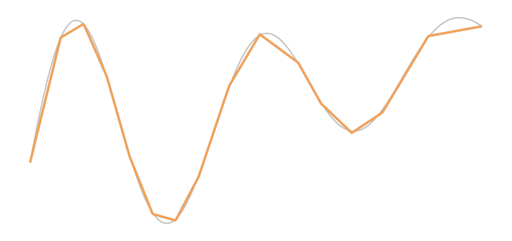

# PiecewiseAffineApprox

[](https://github.com/sintefore/PiecewiseAffineApprox.jl/actions?query=workflow%3ACI)
[](https://codecov.io/gh/sintefore/PiecewiseAffineApprox.jl)
[](https://sintefore.github.io/PiecewiseAffineApprox.jl/stable/)
[](https://sintefore.github.io/PiecewiseAffineApprox.jl/dev/)

Piecewise affine approximations of functions and data, ready to use in
[JuMP](https://jump.dev/) optimization models.



PiecewiseAffineApprox fits convex, concave or general (difference of convex)
piecewise affine functions to a function or to data, and adds them to JuMP
models as linear or mixed-integer constraints. Convex and concave
approximations become pure linear programs, and general ones need binary
variables only where the curvature works against the objective.

Five fitting algorithms share one interface:

| Algorithm | Idea | Based on |
|:--|:--|:--|
| `MILP` | Optimal assignment of points to planes | [Toriello & Vielma (2012)](https://doi.org/10.1016/j.ejor.2011.12.030) |
| `Cluster` | Partition the points and refit, from random starts | [Magnani & Boyd (2009)](https://doi.org/10.1007/s11081-008-9045-3) |
| `Interpol` | Best knots among the data points, as a shortest path with at most K arcs (one variable) | [Dahl & Realfsen (2000)](https://doi.org/10.1002/1097-0037(200008)36:1%3C1::AID-NET1%3E3.0.CO;2-B) |
| `Progressive` | Add planes until a tolerance is met | [Kazda & Li (2024)](https://doi.org/10.1016/j.ejor.2023.07.026) |
| `FullOrder` | One plane per data point | [Kazda & Li (2024)](https://doi.org/10.1016/j.ejor.2023.07.026) |

The number of planes can be chosen with `Select`, by a tolerance, an
information criterion or cross validation, and the error is measured with
`approximation_error`. Approximations can be restricted to one side of the
data, or of a function over its whole domain.

## Usage

```julia
using JuMP, PiecewiseAffineApprox, HiGHS

# A convex approximation of x² + 1/x on [0.2, 2] with five planes
cost = approx(x -> x[1]^2 + 1 / x[1], [(0.2, 2)], Convex(), Interpol(planes = 5))

m = Model(HiGHS.Optimizer)
@variable(m, 0.2 ≤ x[1:3] ≤ 2)
@constraint(m, sum(x) ≥ 3)
# Calling the approximation on JuMP variables adds it to the model
@objective(m, Min, sum(cost(x[i]) for i in 1:3))
optimize!(m)
objective_value(m)  # 6.1
```

A non-convex function is approximated as the sum of a convex and a concave
part with `DC()`. When the output is only minimized, only the concave part
needs binary variables:

```julia
dc = approx(sin, [(0, 2π)], DC(), Interpol(planes = 5, concave_planes = 2))
@variable(m, 0 ≤ y ≤ 2π)
w = dc(y; direction = PiecewiseAffineApprox.Epigraph())
```

Plotting is available when Makie or Plots is loaded, and saving and loading
when JSON is loaded. See the
[documentation](https://sintefore.github.io/PiecewiseAffineApprox.jl/stable/)
for more.
