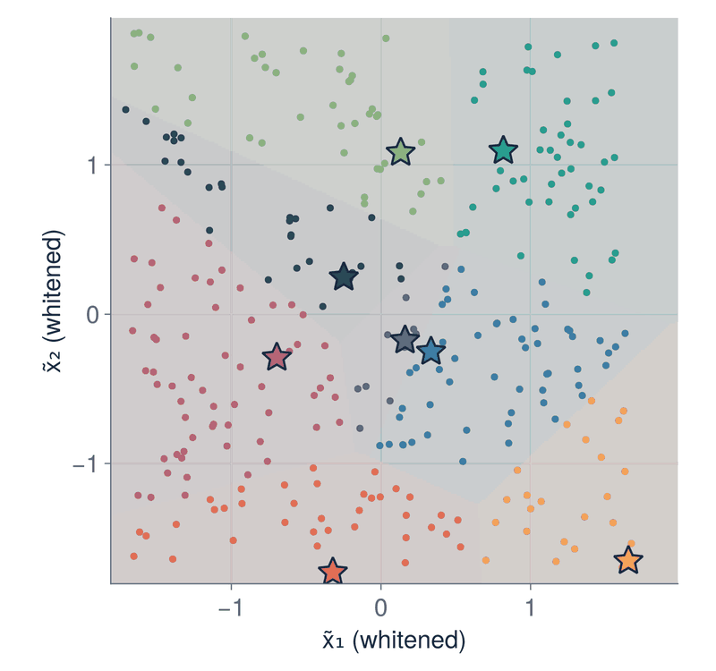
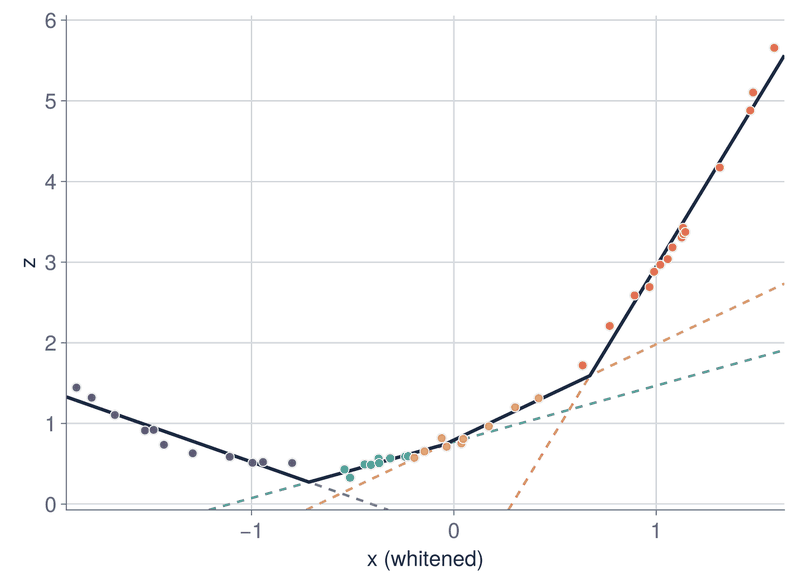
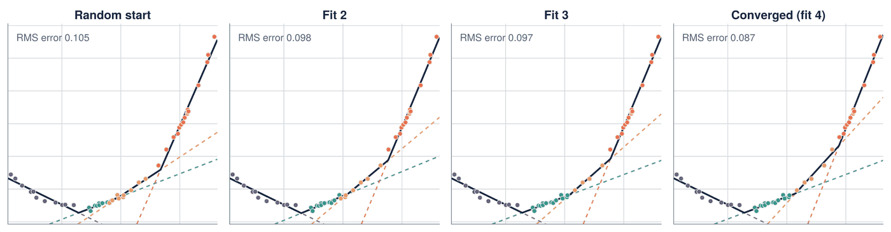
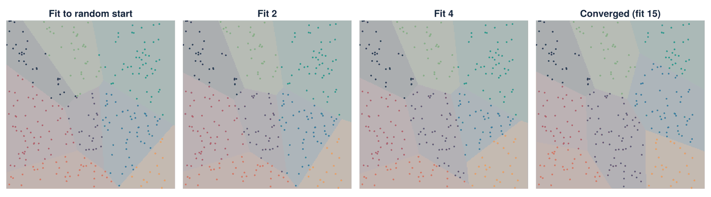
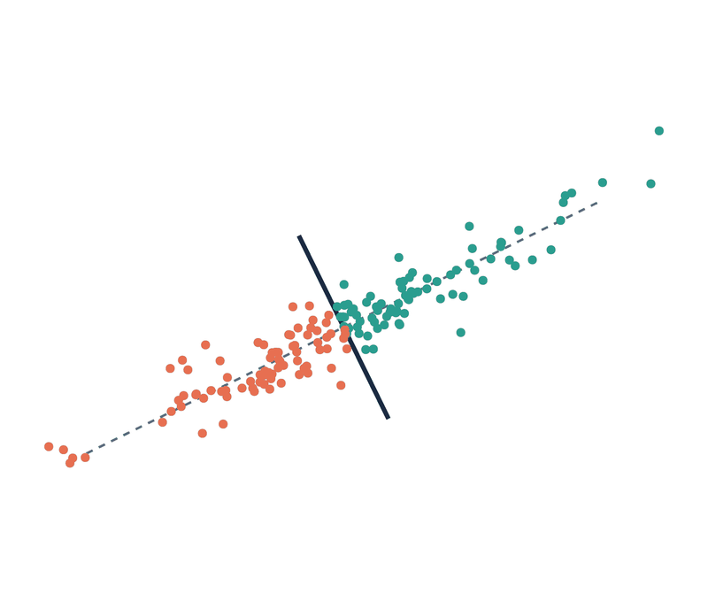
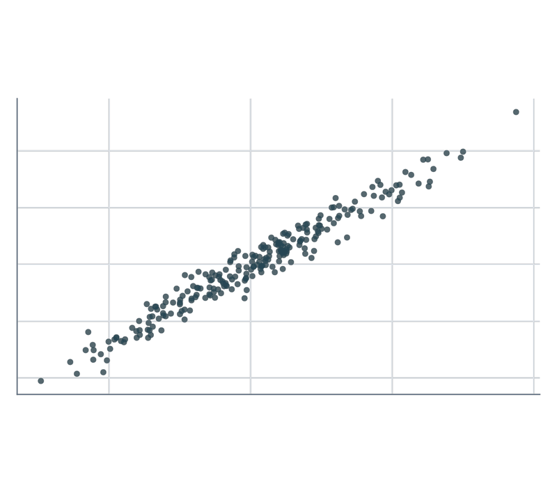
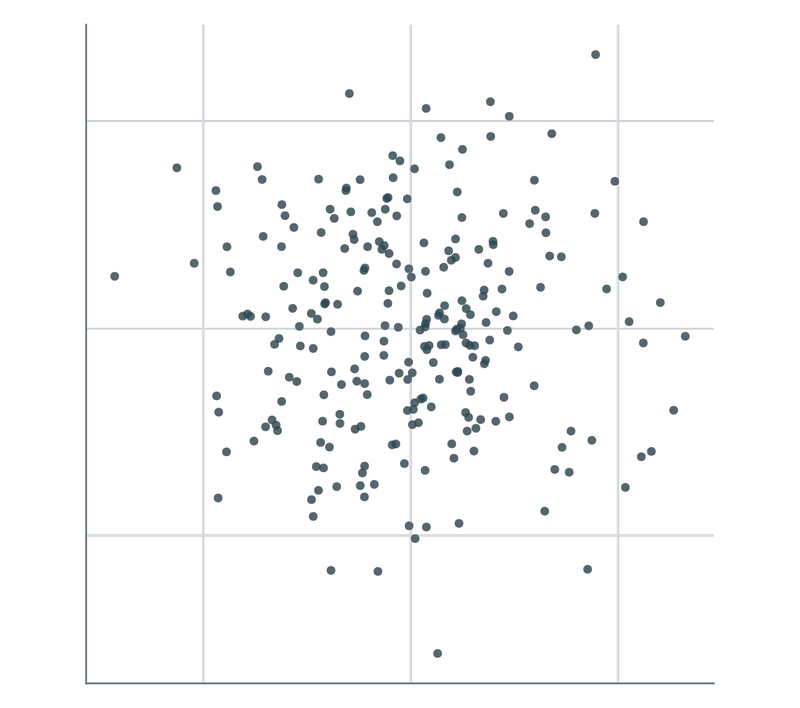
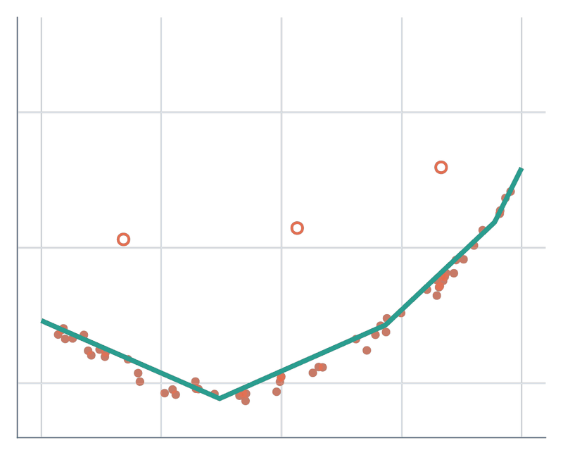
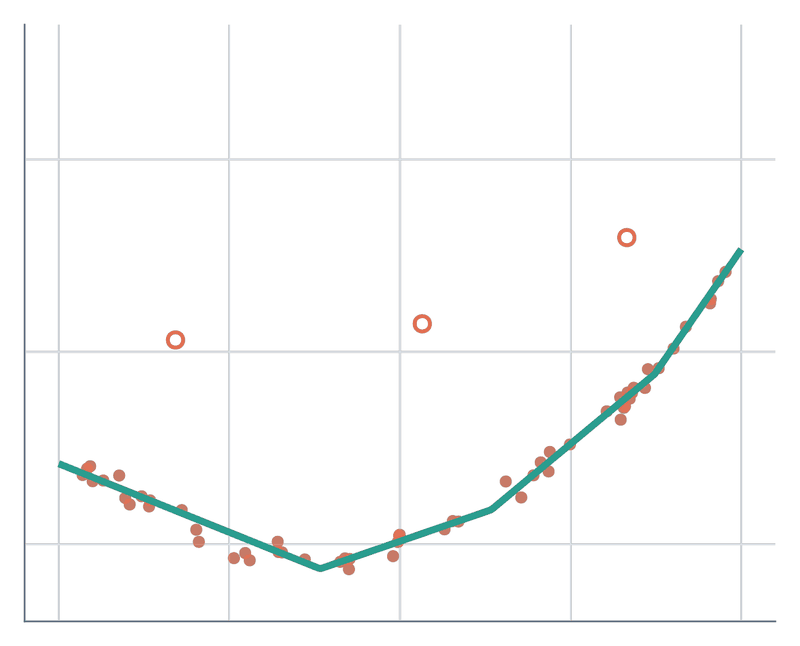
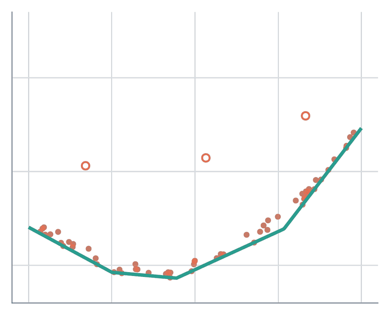

# Cluster

[`Cluster`](@ref) is a fast heuristic for convex piecewise affine fits in any
number of variables, after Magnani & Boyd (2009). It needs no solver in its
default least squares form, and handles many thousands of points.

## The idea: alternate grouping and fitting

1. **Random start:** split the points into ``K`` sets.
2. **Fit:** one plane for each set.
3. **Reassign:** each point joins the plane that is highest at it.
4. **Repeat** from 2 until no point changes set, or `itlim = 50` iterations,
   and return the best fit seen.

This is like k-means with planes as the centres, except that a point does not
join the nearest centre but the plane that is active (largest) at it. Since a
convex piecewise affine function is the maximum of its planes, each set ends
up exactly where its plane forms the maximum.

## Step 1: a random start

``K`` random centres are drawn from a normal distribution with the mean and
covariance of the data points, and each point joins the set of the nearest
centre. This gives a random, roughly balanced partition, whatever the shape of
the point cloud. The centres come from the option `rng`: pass a seeded
generator, e.g. `StableRNG(123)`, for reproducible results.

*300 points in two variables, ``K = 8``. Stars: random centres; shading: the
regions of the nearest centre.*

## Step 2: fit one plane to each set

With `metric = :l2` and `strict = :none` (the defaults), each plane is a
closed-form least squares fit, which is very fast and needs no solver. Other
metrics (`:l1`, `:max`) and `strict = :outer` or `:inner` solve a small LP or
QP for each set with the given `optimizer`. With `:outer`, every plane must lie
below all data points, not only those of its set.

*The random start of an example in one variable with 4 sets: dashed lines are
the fits of the sets, the solid line their maximum.*

The fit is local: each plane only sees its own set. A plane that fits its set
well can still be overruled elsewhere by the maximum, which the next step
corrects.

## Step 3: reassign, refit, repeat

Each point moves to the plane that is active at it, and the planes are fitted
again to their new sets. In the example, the partition stops changing after
four fits, and the RMS error falls from 0.105 to 0.087:

In two variables, the regions where each plane is active settle in a few
iterations. Different starts end in different local optima:

## Restarts: the best of 20

Since each trial only finds a local optimum, `Cluster` runs `trials = 20`
trials from different random starts and keeps the one with the smallest error,
through [`Restart`](@ref). The seeds of the trials are drawn from `rng` up
front, so the result is reproducible whatever the number of threads, and the
trials run in parallel on Julia threads. Mind solver licences that limit the
number of parallel instances. In the two-variable example, the worst of 20
trials had 1.7 times the error of the best.

## Robust by design

| Sets that cannot carry a plane | Same result in any coordinates |
|:--:|:--:|
|  |   |
| Sets with too few points, or no spread in some direction, are dropped and their points reassigned. To keep ``K`` planes, the set with the largest error is split at the median along its principal direction (dashed). | The points are whitened first (centred, unit covariance), so stretching, rotating or shifting the inputs gives the same approximation, as Magnani & Boyd recommend. |

## Choose the error measure and the side

| `metric = :l2` | `metric = :l1` | `metric = :l1, strict = :outer` |
|:--:|:--:|:--:|
|  |  |  |
| The default: closed-form least squares, no solver. Squared errors weigh outliers (open circles) heavily. | Less sensitive to outliers; an LP for each set. | Every plane below all points: an under-estimator. |

For the fits that need a solver, each trial first refines its partition with
fast least squares, and then for at most five iterations with the requested
fit. LP and QP fits tend to cycle early, and this is both faster and better
than the requested fit alone.

!!! warning "Use a robust QP solver for `:l2` with `strict`"
    With `metric = :l2` and `strict = :outer` or `:inner`, each fit is a
    convex quadratic program, on which the QP solver of HiGHS can fail. Use
    e.g. Ipopt or Xpress for this combination. HiGHS works well for the linear
    programs of `:l1` and `:max`.

## When to use Cluster

| Points | 250 | 500 | 1 000 | 2 000 | 4 000 | 8 000 | 16 000 |
|:--|:--|:--|:--|:--|:--|:--|:--|
| Seconds | 0.04 | 0.08 | 0.22 | 0.48 | 0.97 | 2.6 | 4.6 |

*Two variables, 8 planes, 20 trials, default settings, one thread on a
laptop. Indicative only.*

**Strengths:** any number of variables, many points, no solver needed for
least squares, and a run time that grows roughly linearly with the number of
points.

**Limits:** a heuristic, with local optima and no guarantee of optimality, and
a fixed number of planes.

**Use it** for data in several variables or large data sets, and wrap it in
[`Select`](@ref) to choose the number of planes.
