# Difference of convex

Functions that are neither convex nor concave are approximated with
[`DC`](@ref) as the sum of a convex and a concave piecewise affine function,
``f = z_1 + z_2``, which is the same as a difference of two convex functions.
The result is a [`DCFunc`](@ref).

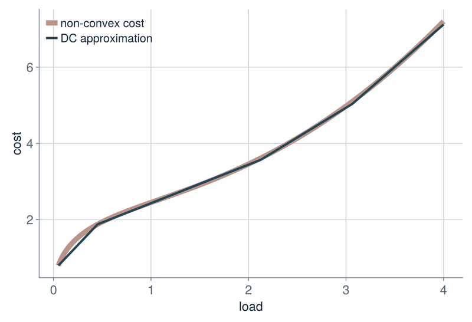

*A cost that is concave at low load and convex at high load: 3 convex and 2
concave planes.*

- **Covers every shape.** Any continuous piecewise affine function is the sum
  of a convex and a concave part.
- **Binaries only where needed.** When the output is minimized, the convex
  part is a pure LP and only the concave part needs binary variables.
- **Any fitting algorithm.** MILP, Cluster, Interpol, Progressive and
  FullOrder all fit the two parts.

The method has four steps: split the data, fit each part, refit the parts
alternately, and model the result with binary variables where needed.

## Step 1: split the data

[`dc_decomposition`](@ref) splits the values into a convex and a concave part
at the same points, which sum to the data. The split is not unique. The
concave part is the expensive one to model, so it is chosen with as little
curvature as possible, and convex data gives a zero concave part.

In one variable with distinct points, the split is computed directly:

| Data | Slope changes | Two parts |
|:--:|:--:|:--:|
| 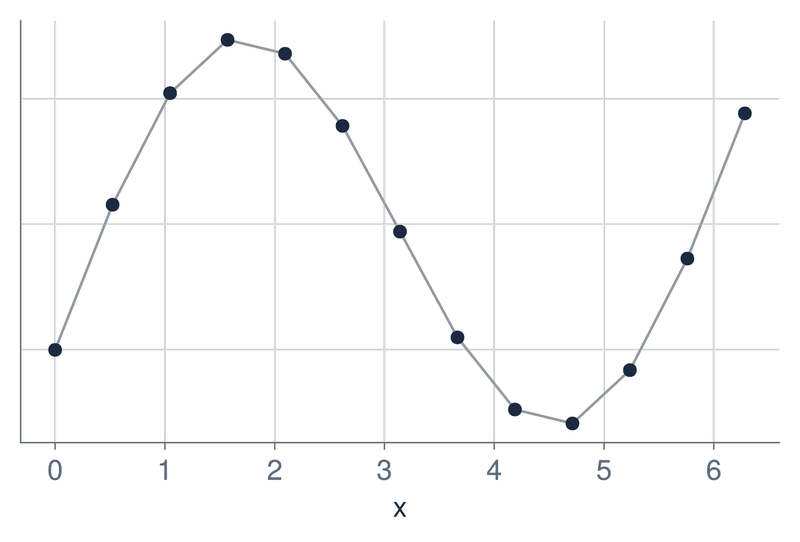 | 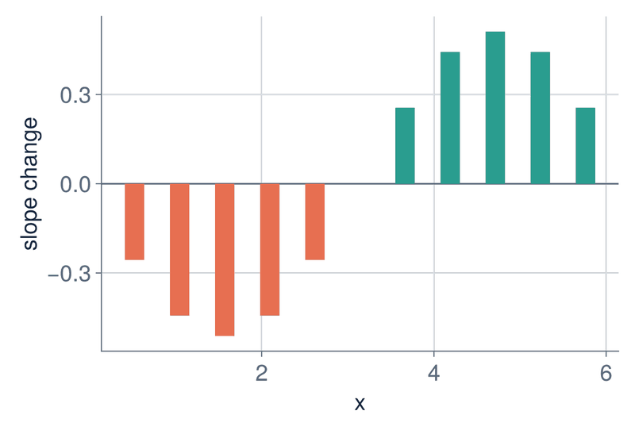 | 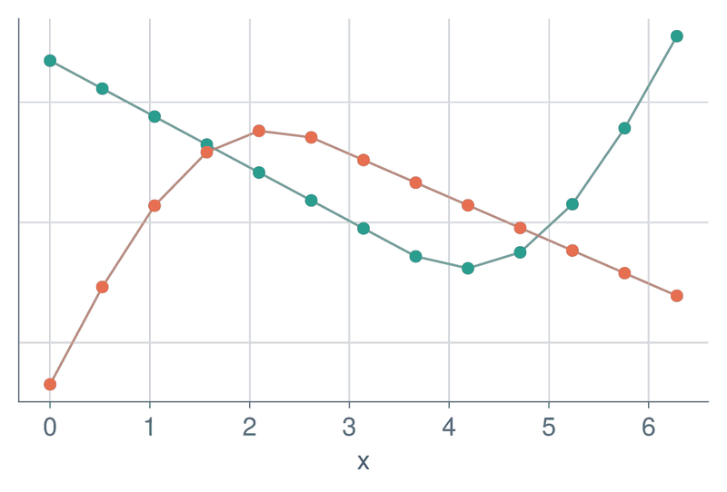 |
| Points sorted by ``x``. | 5 increases (teal), 5 decreases (coral). | Convex (teal) + concave (coral) = data. |

The decreases of the slope form the concave part. The convex part is the data
minus the concave part, and the affine trend of the concave part is moved to
the convex part. No solver is needed.

In several variables, or with repeated points, a linear program finds a convex
``v`` such that ``z + v`` is also convex, with ``v`` as close to affine as
possible (by default in the `:l1` sense). The convex part is ``z + v`` and the
concave part ``-v``. The convexity constraints between all pairs of points
would be too many, so they are added lazily, only when violated: the 169
points below were split in 0.74 s with HiGHS.

| Data | Convex part ``z + v`` | Concave part ``-v`` |
|:--:|:--:|:--:|
| 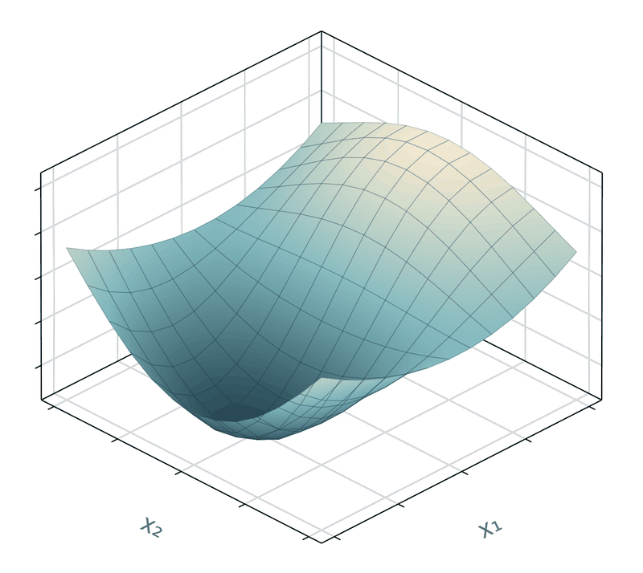 | 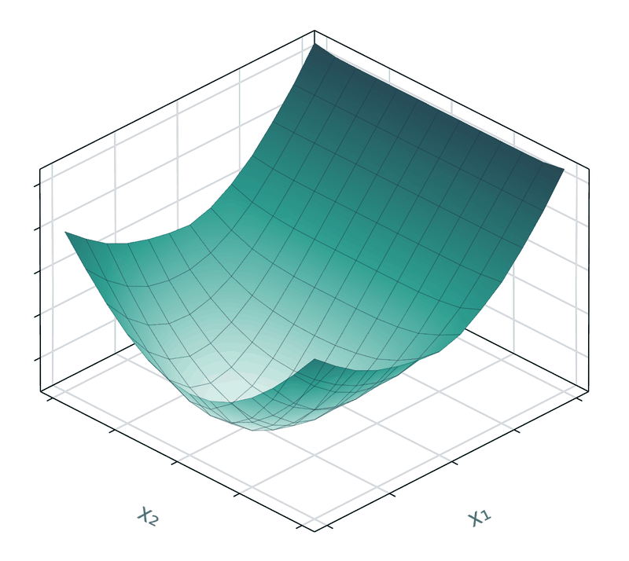 | 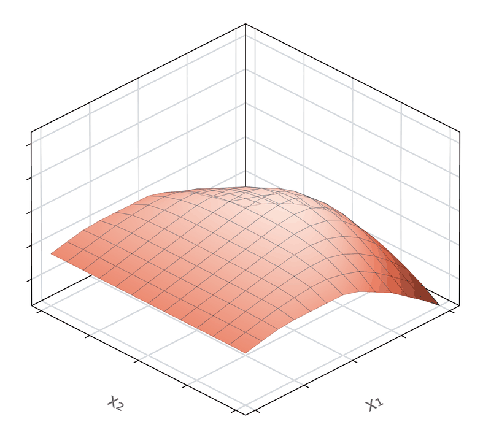 |

## Step 2: fit each part

Each part is now ordinary convex or concave data, fitted with any algorithm:
`planes` planes in the convex part and `concave_planes` in the concave part.

| Convex part, `planes = 5` | Concave part, `concave_planes = 3` | Sum |
|:--:|:--:|:--:|
| 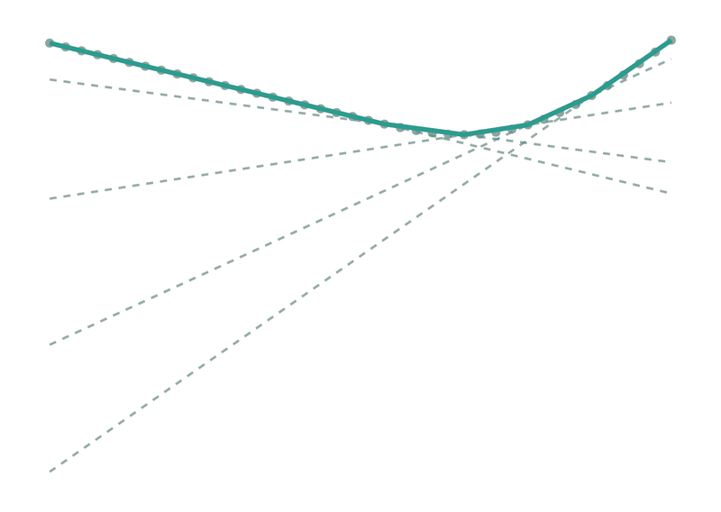 | 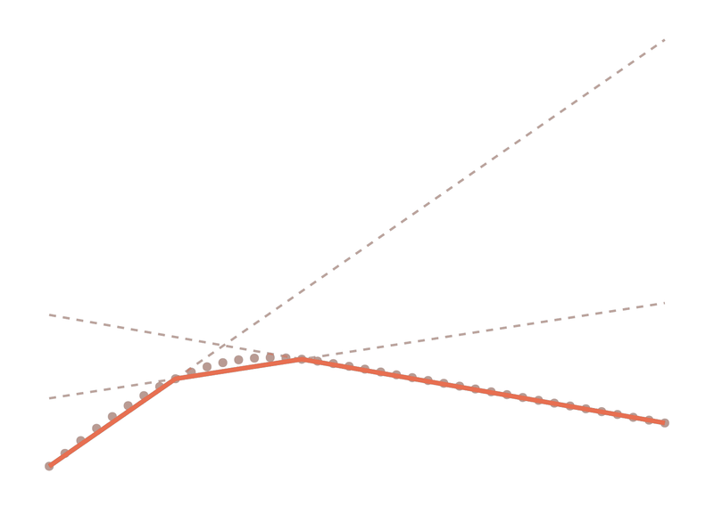 | 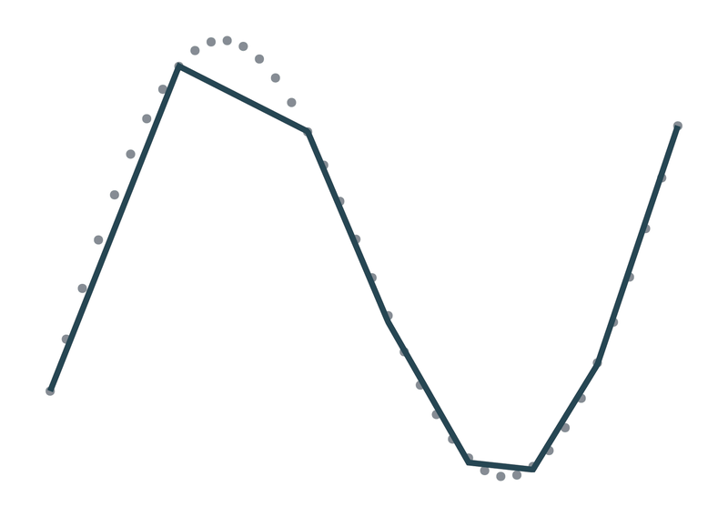 |

Give the concave part fewer planes: when the output is minimized, each of its
planes costs a binary variable. [`Alternating`](@ref) fits the parts with
different algorithms, e.g. an exact [`MILP`](@ref) for a small concave part and
[`Cluster`](@ref) for the convex part.

## Step 3: refit the parts alternately

The split of step 1 is not necessarily the best for the final fit. So each
part is refitted in turn to the data minus the other part:

```math
z_1 \leftarrow \operatorname{fit}(z - z_2), \qquad
z_2 \leftarrow \operatorname{fit}(z - z_1).
```

| After the split | After the refits |
|:--:|:--:|
| 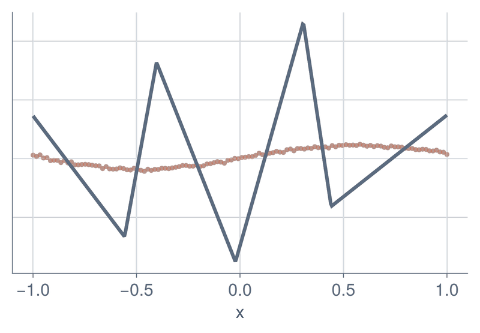 | 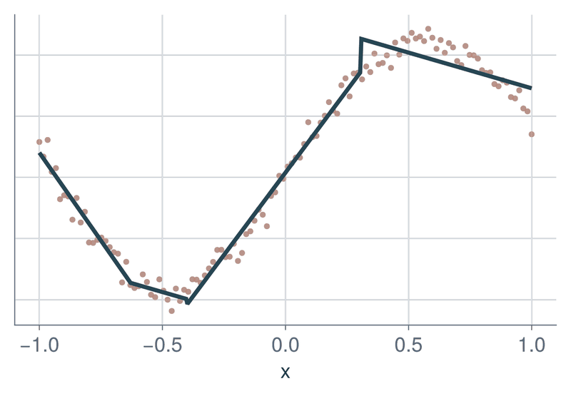 |
| RMS error 4.21 | RMS error 0.113 |

*Cluster, 4 + 3 planes. The parts after the split are large and nearly
cancel, so their separate fitting errors add up until the refits fit them
against each other.*

The best pair is kept, and the refits stop at a fixed point, or after at most
5 rounds by default (the option `iterations` of [`Alternating`](@ref)).
[`Progressive`](@ref) and [`FullOrder`](@ref), which need convex data, are not
refitted.

## Tolerance and side apply to the whole

A tolerance ``δ`` refers to the sum of the parts, so it is divided between
them:

1. The convex part gets ``δ/2``.
2. The concave part gets ``δ`` minus the error of the convex part, and at
   least ``δ/4``.
3. Unused slack is reused to refit the parts with fewer planes.

With [`Progressive`](@ref) and ``δ = 0.05`` in the `:max` metric, the parts
reached errors of 0.025 and 0.038, and since their largest errors are at
different points, the whole approximation was within 0.049.

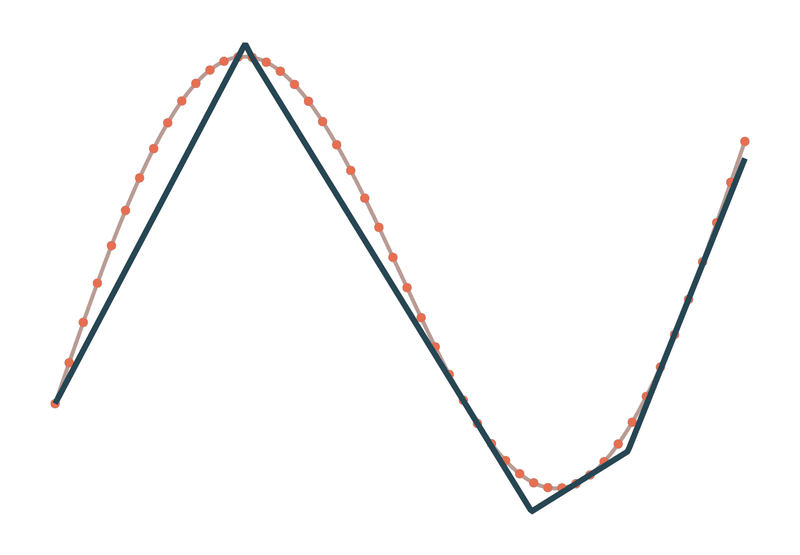

In the same way, `strict = :outer` puts the sum below all data points and
`:inner` above them; the side of the concave part is swapped internally to
achieve this. `everywhere = true` is only available for convex and concave
approximations.

## Step 4: binaries only against the direction

In a model, the output is the sum ``z = z_1 + z_2`` of a variable for each
part. The convex part is bounded below by all its planes, ``z_1 \ge`` every
convex plane, which is exact when ``z`` is minimized; the concave part is
bounded above by all its planes, which is exact when ``z`` is maximized.
Otherwise, a binary variable for each plane selects the active plane, which
bounds the part from the other side, relaxed by a big-M value computed from the
box of ``x`` (or with indicator constraints, `selection = :indicator`).

| Direction | When | Convex part | Concave part |
|:--|:--|:--|:--|
| `Graph()` | ``z = f(x)``, the default | binaries | binaries |
| `Epigraph()` | ``z`` only minimized | LP | binaries |
| `Hypograph()` | ``z`` only maximized | binaries | LP |

| Convex part | Concave part |
|:--:|:--:|
| 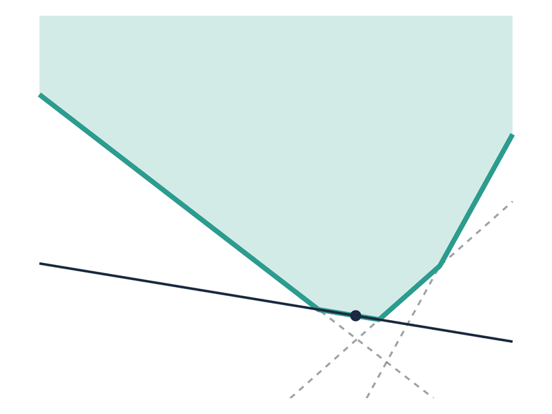 | 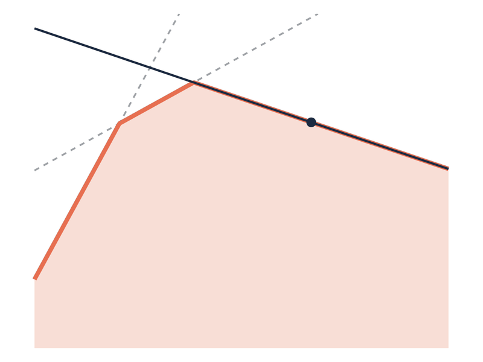 |
| ``z_1 \ge`` every convex plane: exact only with a binary per plane when ``z`` is maximized. | ``z_2 \le`` every concave plane: exact only with a binary per plane when ``z`` is minimized. |

In one variable, the Δ-formulation is better: it needs no big-M values, and
puts binary variables only at the kinks against the direction, e.g. only where
the slope decreases when ``z`` is minimized. For this approximation of
``\sin`` with 7 kinks, that is 3 binaries for the epigraph. It is the default
in one variable when bounds are available, see [Formulations](@ref).

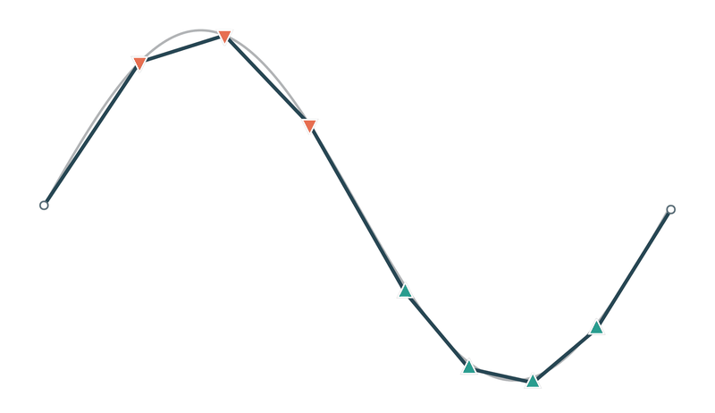

*▲ the slope increases, ▼ the slope decreases.*
