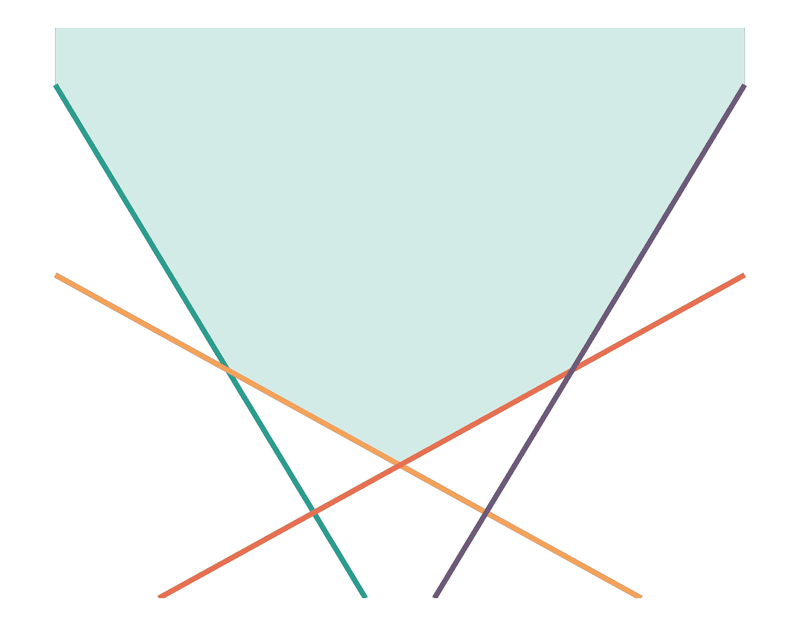
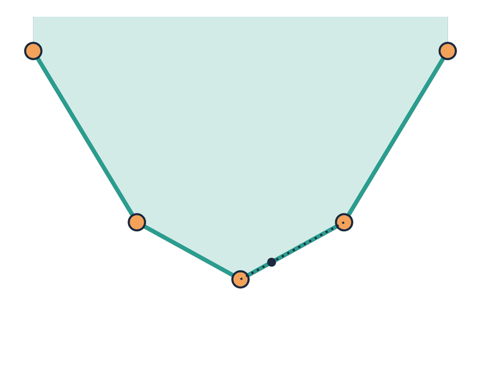
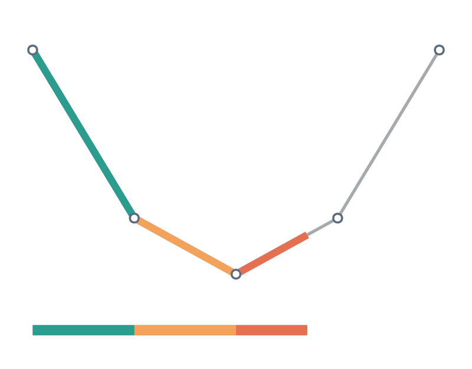
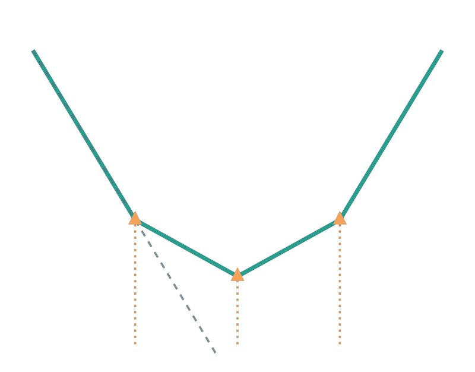
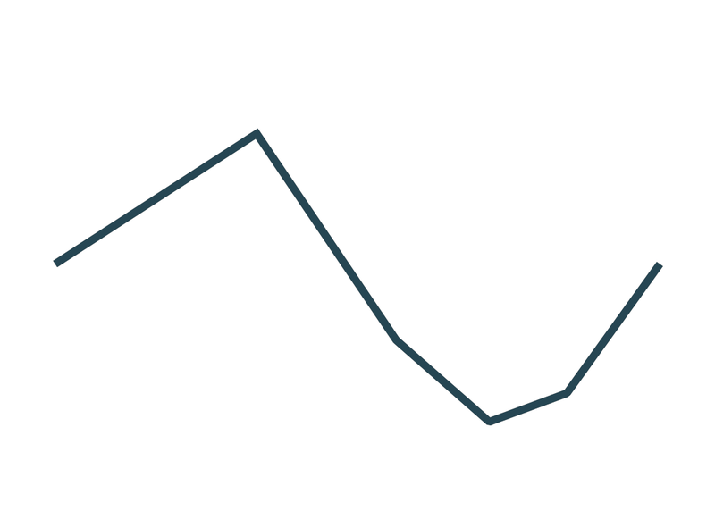
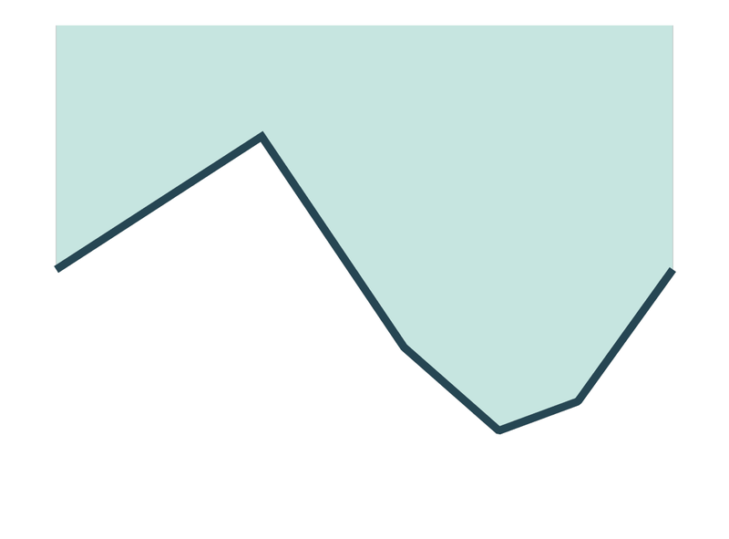
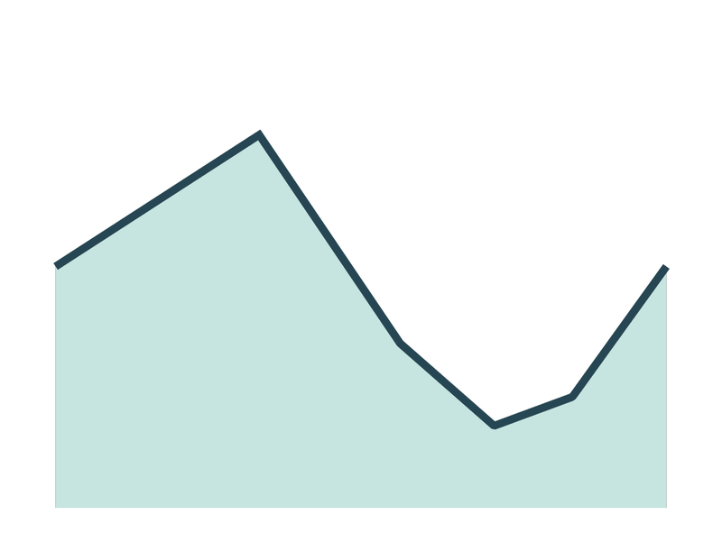

# Formulations

A piecewise affine function is added to a JuMP model by one of four
formulations, which model the same function within the bounds of the inputs.
The formulations and their names follow
[Coffrin et al. (2021)](https://doi.org/10.1016/j.epsr.2021.107191) (preprint:
[arXiv:2005.14087](https://arxiv.org/abs/2005.14087)), which considers
one-dimensional piecewise linear cost functions. The λ-formulation for
functions of two or more variables is a natural extension.

| Ψ: planes | λ: vertices | Δ: segments | Φ: slope changes |
|:--:|:--:|:--:|:--:|
|  |  |  |  |
| One constraint per plane. The smallest model, no preprocessing. | The point is a convex combination of the vertices of the function. | The segments between breakpoints are filled from the left. | The first segment plus the slope change at each breakpoint. |
| Any dimension | Any dimension, needs bounds | One variable | One variable, needs bounds |

For a convex function that is minimized, or a concave function that is
maximized, all four are linear programs without binary variables. They are
selected with the keyword `formulation`, using the types
[`PsiFormulation`](@ref), [`LambdaFormulation`](@ref),
[`DeltaFormulation`](@ref) and [`PhiFormulation`](@ref), or their Greek
aliases `Ψ_Formulation`, `λ_Formulation`, `Δ_Formulation` and `Φ_Formulation`.

## The four formulations

**Ψ-formulation (`PsiFormulation`).** Uses the planes directly, with one
constraint for each plane, ``z \ge \alpha_k^\top x + \beta_k``. It works for
any dimension, gives the smallest model and needs no preprocessing. Bounds on
the inputs are optional. If bounds are given, the output is also bounded by
the smallest and largest value of the function over the bounds, as in Coffrin
et al., which requires vertex enumeration.

**λ-formulation (`LambdaFormulation`).** Represents the point and the output
as a convex combination of the vertices of the function. It works for any
dimension, and requires the vertices of the epigraph (for a convex function) or
the hypograph (for a concave function) within the bounds of the inputs, which
are computed first.

**Δ-formulation (`DeltaFormulation`).** Exploits the ordered breakpoints of a
function of one variable. Each segment between two consecutive breakpoints is
a "bin" with a variable for how much of it is used, i.e. the formulation
integrates the slope along the ``x``-axis.

**Φ-formulation (`PhiFormulation`).** Extends the first segment over the
whole domain, and adds the change in slope at each later breakpoint. It is the
dual of the Δ-formulation, uncommon in practice, and included mainly for
completeness. Like Δ, it handles one variable only.

The λ, Δ and Φ formulations need a bounded domain. The bounds are taken from
the keyword `bounds`, the [`domain`](@ref) of the function, or the bounds of
the variables, in that order. For the one-dimensional formulations, adjacent
segments with nearly equal slopes are merged to avoid redundant variables.

## The direction decides where binaries are needed

The formulations model the epigraph ``z \ge f(x)`` of a convex function, or
the hypograph ``z \le f(x)`` of a concave function. The output then only equals
the function when the objective pushes it towards the function. The keyword
`direction` states how the output is used:

| `Graph()` | `Epigraph()` | `Hypograph()` |
|:--:|:--:|:--:|
|  |  |  |
| ``z = f(x)``. The default for a [`DCFunc`](@ref). Binaries for both parts. | ``z \ge f(x)``, when ``z`` is only minimized. Binaries only for the concave part; a convex function is a pure LP. | ``z \le f(x)``, when ``z`` is only maximized. Binaries only for the convex part; a concave function is a pure LP. |

A convex or concave function in the other direction is modelled as a
[`DCFunc`](@ref) with an empty part, with binary variables. The directions are
not exported: use e.g. `PiecewiseAffineApprox.Epigraph()`.

## Formulation matters for non-convex functions

When binary variables are needed, the Ψ-formulation selects the active plane of
each part with a binary variable per plane and big-M constraints, see
[Difference of convex](@ref). In one variable, the Δ- and Φ-formulations model
the function by its breakpoints over the bounds instead, with one binary
variable at each kink of the wrong curvature for the direction. They are
ideal and need no big-M values.

| Formulation | Solve time, 200 non-convex cost functions |
|:--|:--|
| Ψ with big-M selection | 50 s |
| Φ | 1.3 s |
| Δ | 0.1 s |

*The dispatch benchmark in PWABenchmarks.jl (`scripts/formulations.jl`), with
one-dimensional difference of convex cost functions. With 1000 functions, the
Ψ-formulation did not finish within two minutes.*

## Choosing a formulation

When no formulation is given, it is chosen from the function and the
direction, following this benchmark:

- **Convex or concave function in its natural direction:** the Ψ-formulation,
  a linear program that gives the smallest model and needs no bounds.
- **A function of one variable that needs binary variables** (a
  [`DCFunc`](@ref), or another direction): the Δ-formulation, if bounds are
  available.
- **Otherwise:** the Ψ-formulation, with big-M or indicator selection of the
  active planes.

For linear programs, e.g. with HiGHS, the choice matters little: in the
experiments of Coffrin et al. (DC optimal power flow), λ and Δ were fastest on
average, but all formulations were within a factor of 1.7 of the best. With
interior point solvers for nonlinear models, e.g. Ipopt or Knitro, avoid the
Ψ-formulation: Coffrin et al. found it on average 5 and up to 10 times slower
than the others for AC optimal power flow. λ and Δ performed best there, with λ
best for convex (second order cone) relaxations.

New formulations can be added outside the package, see
[Add a formulation](@ref).
