# Interpol

[`Interpol`](@ref) fits convex functions of one variable. It builds on the
work of Dahl & Realfsen, who formulated piecewise linear curve approximation as
a *cardinality-constrained shortest path problem*: choosing the knots among the
data points is a shortest path through an acyclic graph, using at most ``K``
arcs. Interpol solves this problem exactly by dynamic programming, and adds
the constraint that the result is convex. It is fast, deterministic and needs
no solver, which makes it a good default for any convex function of one
variable.

## Interpolate a well-chosen subset of the points

The fitted function is a polyline through some of the data points. With ``K``
planes there are ``K`` segments, so ``K + 1`` knots, including the first and
last points, which are always knots. The other knots are chosen to minimize the
deviation of the remaining points, in the `:l1`, `:l2` or `:max` metric.

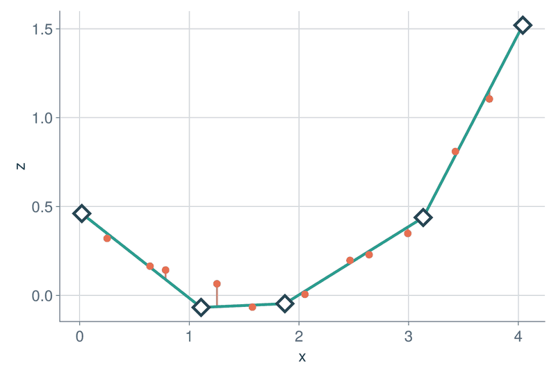

*16 noisy points, 4 planes. Diamonds are knots, red lines the residuals of the
other points.*

The points are sorted, and points with the same ``x`` value are grouped; every
measurement still counts in the error.

## Curve approximation as a shortest path

Following Dahl & Realfsen, the choice of knots is a path in a graph:

| Curve approximation | Graph |
|:--|:--|
| The data points ``1, …, N``, sorted by ``x`` | The nodes |
| A candidate segment between points ``i < j`` | An arc ``(i, j)`` |
| The deviation of the points between ``i`` and ``j`` from the segment | The weight ``p_{ij}`` of the arc |
| A choice of knots, from the first to the last point | A path from node ``1`` to node ``N`` |
| The number of segments, i.e. of planes | The number of arcs on the path |
| The total deviation | The length of the path |

All arcs point from left to right, so the graph is acyclic, and with ``N``
points it has ``N(N-1)/2`` arcs. Without a limit on the number of arcs, the
best path would use every point as a knot and interpolate all the data. The
number of planes is therefore a *cardinality constraint* on the path: it may
use at most ``K`` arcs. This is what makes the problem harder than an ordinary
shortest path problem.

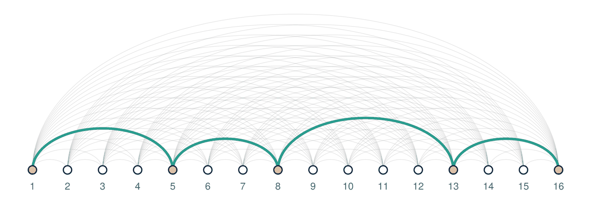

*Every arc is a candidate segment ``i → j`` with weight ``p_{ij}``. The
highlighted path is the optimal choice of 4 segments.*

Dahl & Realfsen studied the polytopes of this problem, showed that it can be
solved by linear programming for the class of graphs they call 2-graphs, and
gave a combinatorial algorithm based on adjacency of the polytopes. They
compared it with Lagrangian relaxation and dynamic programming on curve
approximation problems. Interpol uses dynamic programming, which extends
directly to the convexity constraint below and to the `:max` metric.

## Step 1: the arc weights

For every pair of points ``i < j``, the weight ``p_{ij}`` is the deviation of
the points ``i, …, j-1`` from the segment between ``i`` and ``j``: the sum of
absolute deviations (`:l1`), the sum of squares (`:l2`), or the largest
deviation (`:max`). Each point belongs to exactly one segment, and the last
point is always a knot. For least squares, all ``N^2`` weights are computed in
``O(N^2)`` time with prefix sums.

| One candidate segment | All arc weights |
|:--:|:--:|
| 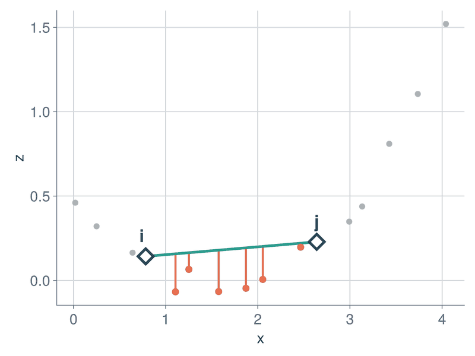 | 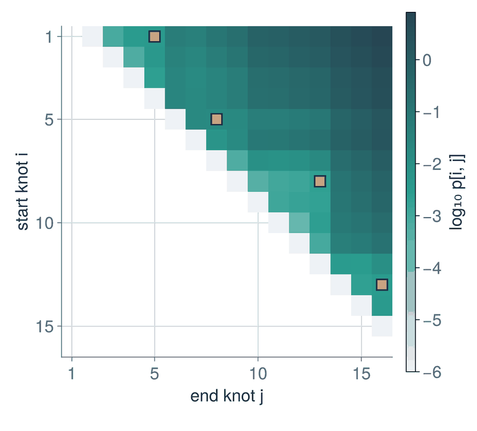 |
| ``p_{ij}``: the deviation of the points between ``i`` and ``j`` from the segment. | The squares mark the arcs of the optimal path. |

## Step 2: dynamic programming over the number of arcs

The cardinality constraint is handled by counting the arcs. Let ``c_{s,j}`` be
the length of the shortest path from node ``1`` to node ``j`` with exactly
``s`` arcs. Since every path to ``j`` arrives by some arc ``(i, j)`` from a
node to its left,

```math
c_{1,j} = p_{1j}, \qquad
c_{s,j} = \min_{i < j} \; \bigl( c_{s-1,i} + p_{ij} \bigr), \quad s = 2, …, K.
```

The layers ``s = 1, …, K`` are computed in turn, each in ``O(N^2)`` time, so
the whole table takes ``O(K N^2)`` time, and the knots are found by
backtracking from ``c_{K,N}``. For the `:max` metric, the length of a path is
its largest arc weight, and the sum is replaced by a maximum.

## Step 3: convexity as a constraint on consecutive arcs

A polyline is convex exactly when its slopes are nondecreasing. In the graph,
this is a constraint on *pairs* of consecutive arcs: arc ``(j, l)`` may follow
arc ``(i, j)`` only if it is at least as steep, ``σ_{ij} \le σ_{jl}``, where
``σ_{ij}`` is the slope of the segment between points ``i`` and ``j``. A
shortest path algorithm that only knows the current node cannot check this.

So the state of the dynamic program is the last *arc* ``(i, j)`` instead of
the last node, whose slope is then known. This is a shortest path problem in
the *line graph*, whose nodes are the arcs of the original graph, and whose
arcs join each arc ``(i, j)`` to the arcs ``(j, l)`` that may follow it:

```math
c_{s}(j, l) = p_{jl} + \min_{i < j \,:\, σ_{ij} \le σ_{jl}} c_{s-1}(i, j).
```

The line graph has ``O(N^2)`` nodes but ``O(N^3)`` arcs, so a direct
evaluation would take ``O(K N^3)`` time. Instead, the incoming and outgoing
arcs of each point are sorted by slope. The allowed predecessors of an
outgoing arc are then a prefix of the sorted incoming arcs, which grows with
the slope of the outgoing arc, so a single sweep with a running minimum finds
the best predecessor of every outgoing arc. Each layer then takes ``O(N^2)``
time, and the whole dynamic program ``O(K N^2)`` after sorting.

| Allowed continuations | Without and with the constraint |
|:--:|:--:|
| 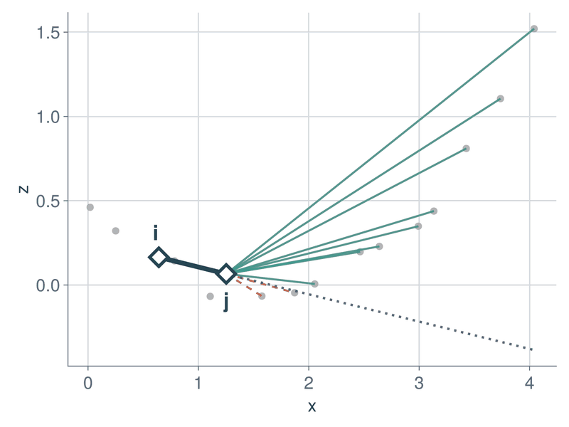 | 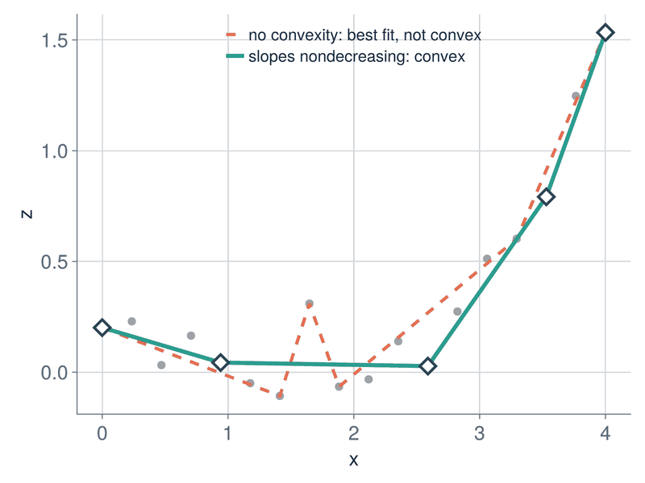 |
| After ``i → j``, only steeper segments may follow (teal), not flatter (red). | Without the constraint, the best path on noisy data is not convex. |

The result is the best convex path with at most ``K`` arcs. It always exists,
since the single arc from the first to the last point is convex.

## Data that is not convex

For noisy or non-convex data there are two strategies, chosen by `convexify`:

| `convexify = :dp` | `convexify = :data` |
|:--:|:--:|
| 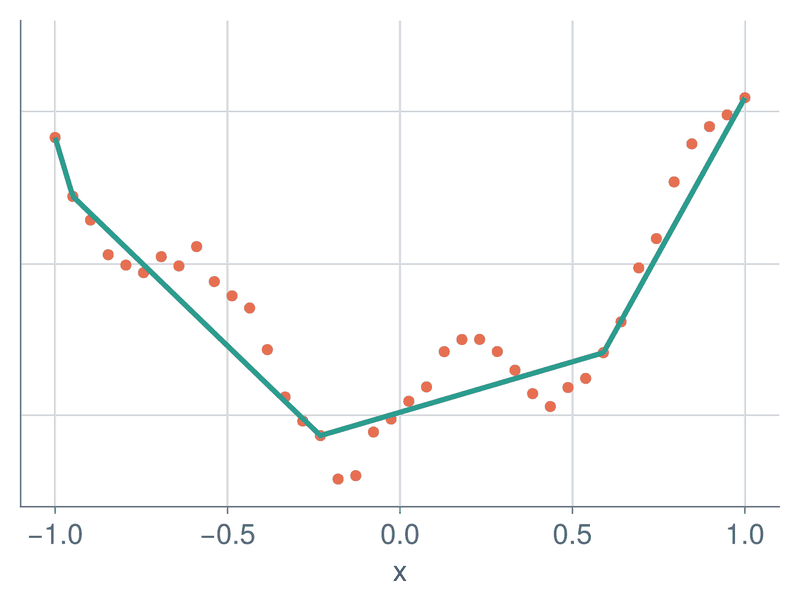 | 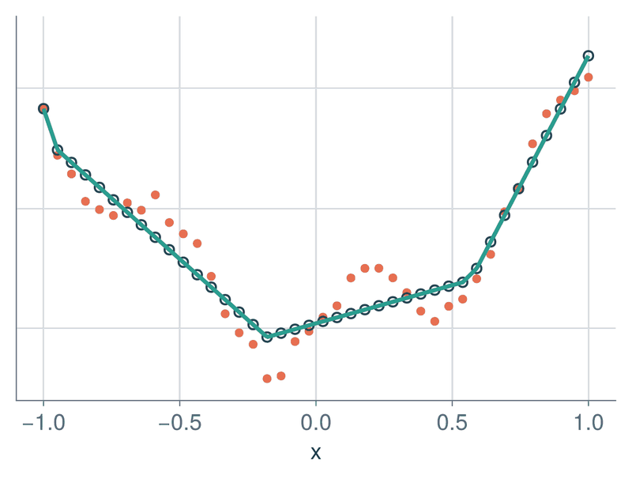 |
| The best convex path through the raw points, as above. Exact, and needs no solver, but can fit data far from convex poorly. RMS error 0.106. | An LP first changes the values as little as possible to make them convex (circles), and the result is interpolated. RMS error 0.093. |

With `:data`, any path through the convexified points is convex, so the
constraint of step 3 holds automatically. The default, `:auto`, uses `:dp` when the
data is convex or no optimizer is given, and otherwise computes both and keeps
the one with the smaller deviation. The errors are always measured against the
original data.

## The metric decides what a good fit is

| `:l1` | `:l2` | `:max` |
|:--:|:--:|:--:|
| 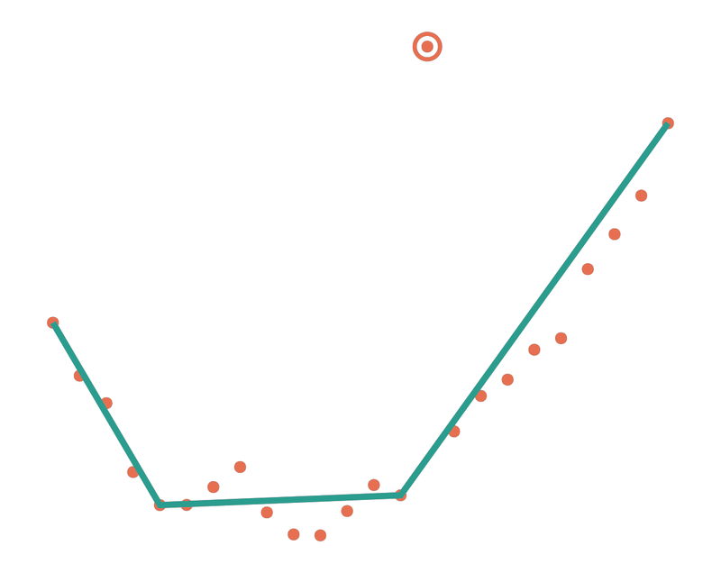 | 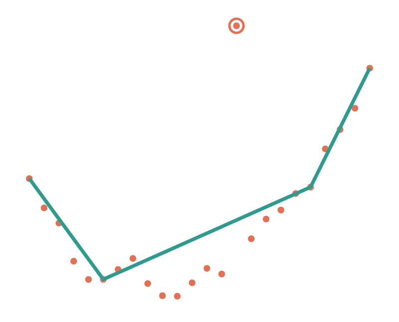 | 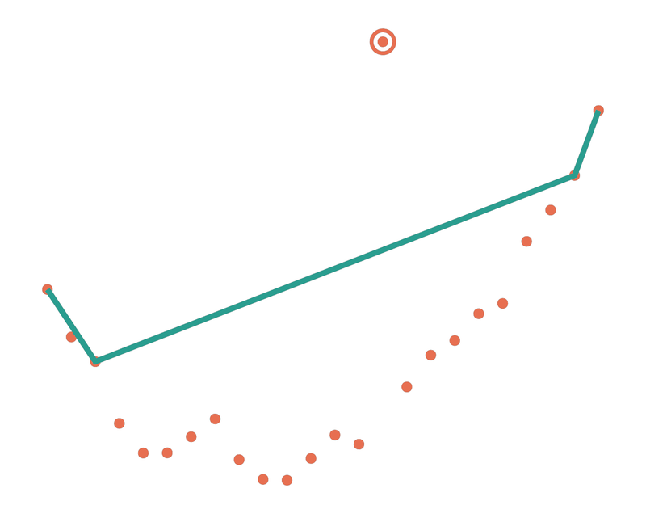 |
| Robust: the outlier (circled) barely moves the fit. | The outlier pulls the middle segment up. | Halves the worst error, so the outlier decides the fit. |

The arc weights and the length of a path follow the metric: sums for `:l1`
(the default) and `:l2`, and a maximum for `:max`, which makes it a bottleneck
shortest path problem. Many paths can share the same largest arc weight, so
for `:max` a second pass picks the one with the smallest total weight among
the paths that use only arcs within the optimal maximum.

## Fine tuning after the knots are chosen

Restricting the knots to data points is a limitation for noisy data. The
option `adjust` relaxes it:

- `:values`: keep the breakpoints and refit the values at the knots, subject to
  convexity. For `:l2`, this is a nonnegative least squares fit in the hinge
  basis ``a + bx + \sum_i c_i \max(0, x - t_i)`` with ``c \ge 0``; `:l1` and
  `:max` need an LP solver.
- `:breakpoints`: also move each interior breakpoint by a golden section
  search between its neighbours, in up to 10 sweeps. This finds a local
  optimum.

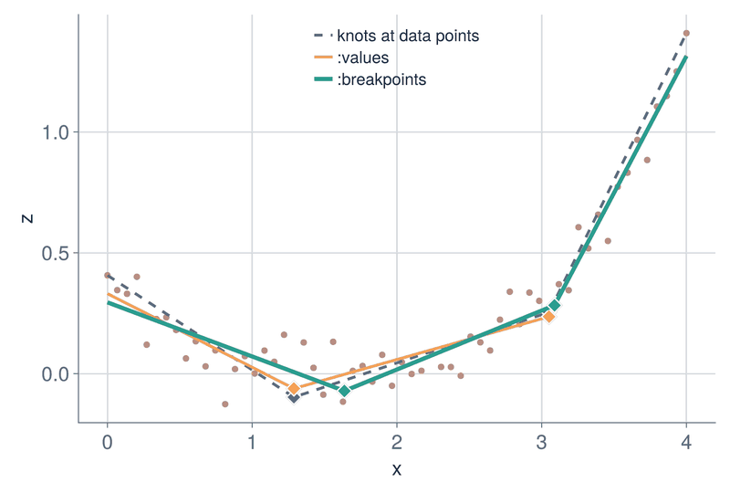

*60 noisy points, 3 planes. The RMS error falls from 0.093 with the knots at
data points to 0.085 with `:values` and 0.083 with `:breakpoints`.*

Adjusting never increases the deviation from the data. The result is then no
longer restricted to knots at data points, and is not guaranteed to be optimal
for free knots.

## Let Interpol choose the number of planes

With the option `selection`, `planes` becomes the largest number considered,
and [`Select`](@ref) picks the number by a criterion. For 120 noisy points of a
smooth convex function with `planes = 12`:

| Criterion | Planes |
|:--|:--|
| `:tolerance`, the fewest planes within 0.015 RMS | 4 |
| `:aic`, Akaike information criterion | 8 |
| `:bic`, Bayesian information criterion, which penalizes planes more | 7 |
| `:cv`, 5-fold cross validation with the one standard error rule | 8 |

The scores are in the `details` of the [`FitResult`](@ref) from
[`fit`](@ref). See [Choose the number of planes](@ref).

## Fast, exact and one-dimensional

The run time is ``O(K N^2)`` and the memory ``(32 + 2K) N^2`` bytes for ``N``
distinct points, so a few thousand points take seconds. A guard stops runs
that would need more than 4 GiB, about 10 000 distinct points with 5 planes;
sample the data first in that case.

| Points | 250 | 500 | 1 000 | 2 000 | 4 000 |
|:--|:--|:--|:--|:--|:--|
| Seconds | 0.003 | 0.016 | 0.11 | 0.69 | 3.4 |

*5 planes, least squares, on a laptop. Indicative only.*

Interpol is exact for its search space, polylines with knots at data points.
With free knots, the best fit can be better; [`MILP`](@ref) finds it, at a much
higher cost, and uses the Interpol fit as one of its warm starts. For more than one variable, use
[`MILP`](@ref) or [`Cluster`](@ref).

## References

- Dahl, G., & Realfsen, B. (1996). *Curve approximation and constrained
  shortest path problems.* Research report, University of Oslo.
  [hdl:10852/9204](https://hdl.handle.net/10852/9204)
- Dahl, G., & Realfsen, B. (2000). The cardinality-constrained shortest path
  problem in 2-graphs. *Networks*, 36(1), 1–8.
  [doi:10.1002/1097-0037(200008)36:1<1::AID-NET1>3.0.CO;2-B](https://doi.org/10.1002/1097-0037(200008)36:1%3C1::AID-NET1%3E3.0.CO;2-B)

The dynamic program of step 2 is also the classical method for optimal
polygonal approximation of curves with vertices at the data points (Perez &
Vidal, *Pattern Recognition Letters*, 1994), and the dynamic program over
slope-sorted edges of step 3 is a standard technique for convex chains in
computational geometry, e.g. in Eppstein, Overmars, Rote & Woeginger, "Finding
minimum area k-gons", *Discrete & Computational Geometry*, 1992
([doi:10.1007/BF02187823](https://doi.org/10.1007/BF02187823)).
