# MILP

[`MILP`](@ref) finds the best convex fit for a given number of planes by
mixed-integer linear programming, following Toriello & Vielma (2012). It is
the method of choice for small data sets where every plane counts, and a
reference to judge the heuristics against.

## Which points share a plane?

Once the points of each plane are known, each plane is an easy fit. But there
are ``K^N`` ways to assign ``N`` points to ``K`` planes, and a natural guess is
often far from the best:

| Equal groups of consecutive points | Optimal assignment from the MILP |
|:--:|:--:|
| 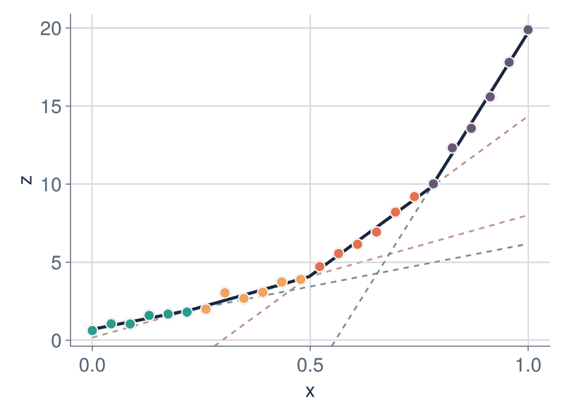 | 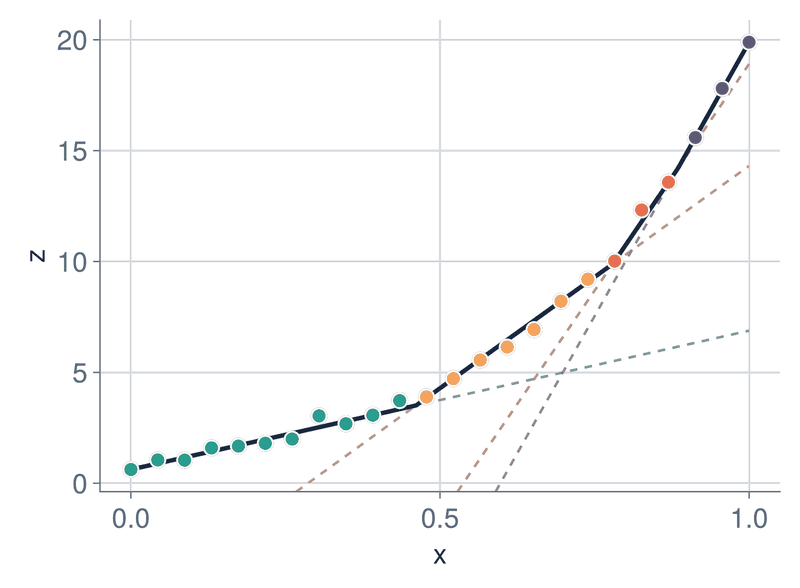 |
| Mean absolute error 0.169 | Mean absolute error 0.143 (−15%) |

*24 noisy points and 4 planes. The colours show the plane of each point.*

The MILP searches all assignments implicitly, with one binary variable for
each point and plane.

## The formulation

For each data point ``(x_p, z_p)`` and plane ``k``, with the plane
coefficients ``a_k, b_k``, the value ``\hat z_p`` of the approximation at the
point and the binary ``u_{pk}`` for point ``p`` using plane ``k``:

```math
\begin{aligned}
\hat z_p &\ge a_k^\top x_p + b_k && \text{for all } k && \text{(never below a plane)} \\
\hat z_p &\le a_k^\top x_p + b_k + M_p (1 - u_{pk}) && \text{for all } k && \text{(equal to the assigned plane)} \\
\textstyle\sum_k u_{pk} &= 1 && && \text{(exactly one plane per point)}
\end{aligned}
```

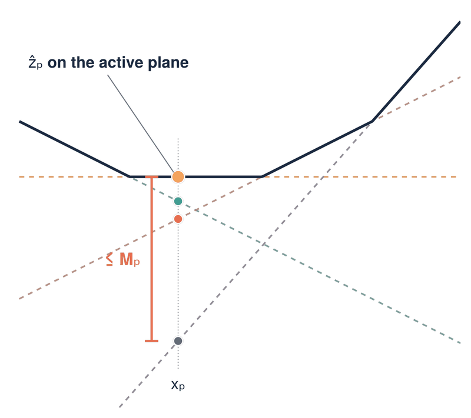

The objective minimizes the deviation between ``\hat z_p`` and ``z_p`` in the
`metric`: the sum of absolute deviations (`:l1`, the default), the largest
deviation (`:max`), or the sum of squares (`:l2`, a mixed-integer quadratic
program, which needs a solver that handles those; HiGHS does not). The option
`strict` adds constraints: with `:outer` every plane lies below every data
point, and with `:inner` the approximation lies above every data point.

| `metric = :l1` | `metric = :max` | `strict = :outer` | `strict = :inner` |
|:--:|:--:|:--:|:--:|
| 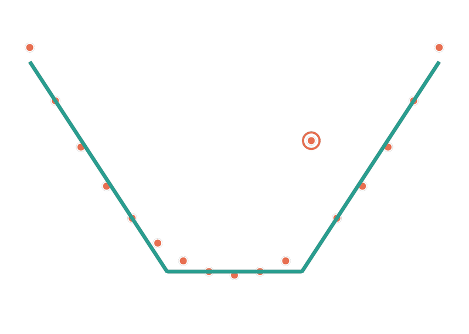 | 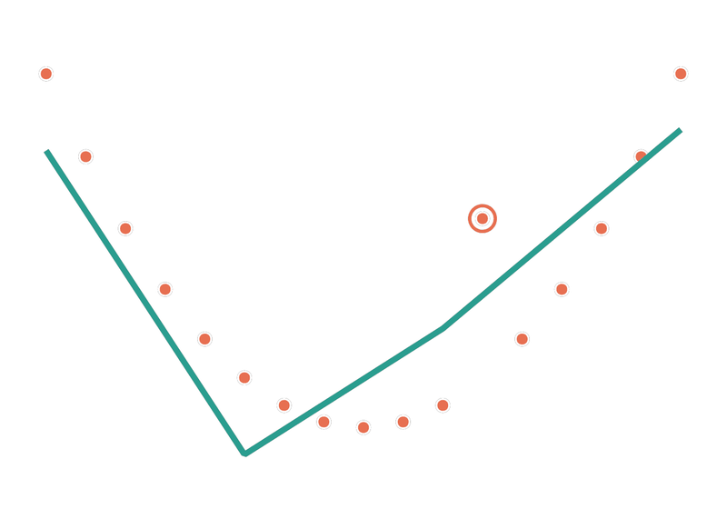 | 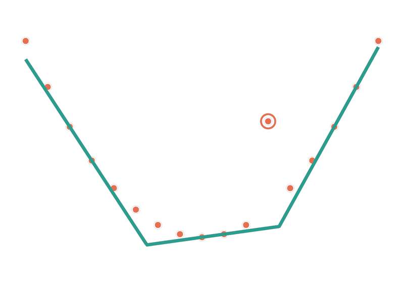 | 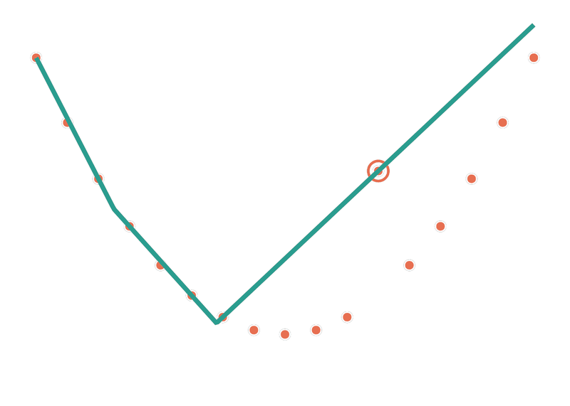 |
| The outlier (circled) is ignored. | The outlier pulls the whole fit. | All planes below every point. | Above every point. |

## Big-M values from the data

``M_p`` must be large enough to cover the distance from point ``p`` down to the
lowest plane. Too small a value cuts off the optimum, and too large a value
weakens the relaxation. The values are computed for each point from the data,
scaled to the unit box:

1. **Candidates.** Lines through neighbouring points with no point in between,
   and in two variables, planes through triangles of points with no point
   inside, skipping slivers.
2. **Per point.** ``M_p`` is the largest drop from point ``p`` down to a
   candidate, plus 10%, then doubled.
3. **Safe for the start.** ``M_p`` is never smaller than the gap of the warm
   start at that point. With more than two variables, the warm start gives the
   values.
4. **Adaptive.** If a big-M constraint is tight for a plane that is not
   active, all ``M_p`` are doubled and the MILP solved again, up to three
   times while the objective improves.

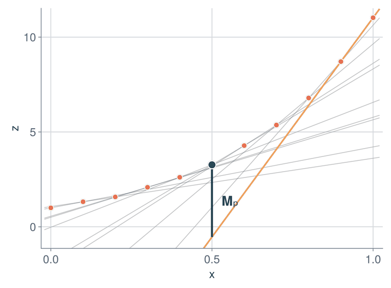

*Grey: lines through neighbouring points. Orange: the candidate furthest
below the highlighted point.*

## A heuristic warm start

With `warmstart = true` (the default), two heuristic fits are tried: a least
squares [`Cluster`](@ref) fit and, in one variable, an [`Interpol`](@ref) fit
in the same metric. They are shifted if needed to satisfy `strict`, and the
best is passed to the solver as a starting solution. Its error ``r`` also
bounds the deviation at every point, ``|\hat z_p - z_p| \le r``, which tightens
the model. The warm start is required for more than two variables.

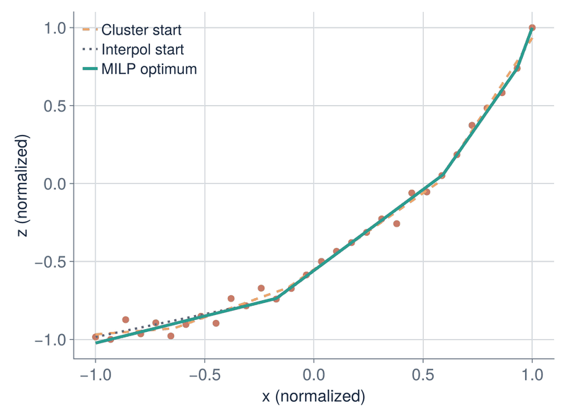

## Breaking symmetry in one variable

Relabelling the planes gives ``K!`` equivalent solutions. In one variable, the
planes are sorted by slope, and then the active plane can only change in one
direction along ``x``: the points of each plane are consecutive, a staircase.
Requiring this removes the equivalent solutions, and speeds up the solver
considerably.


| Planes | Solve time with symmetry breaking | Without |
|:--|:--|:--|
| 4 | 1.1 s | > 60 s (time limit) |
| 5 | 1.9 s | > 60 s |
| 6 | 11.7 s | > 60 s |

*40 points, metric `:l1`, HiGHS on a laptop. Indicative only.*

## Two or more variables

The formulation is the same for any number of variables, only the big-M values
are computed differently. The cost grows quickly with the data: proving
optimality took 27 s for 25 points and 4 planes in two variables, while 36
points and 5 planes were not solved to optimality within 120 s.

| Regions where each plane is active | Fitted surface |
|:--:|:--:|
| 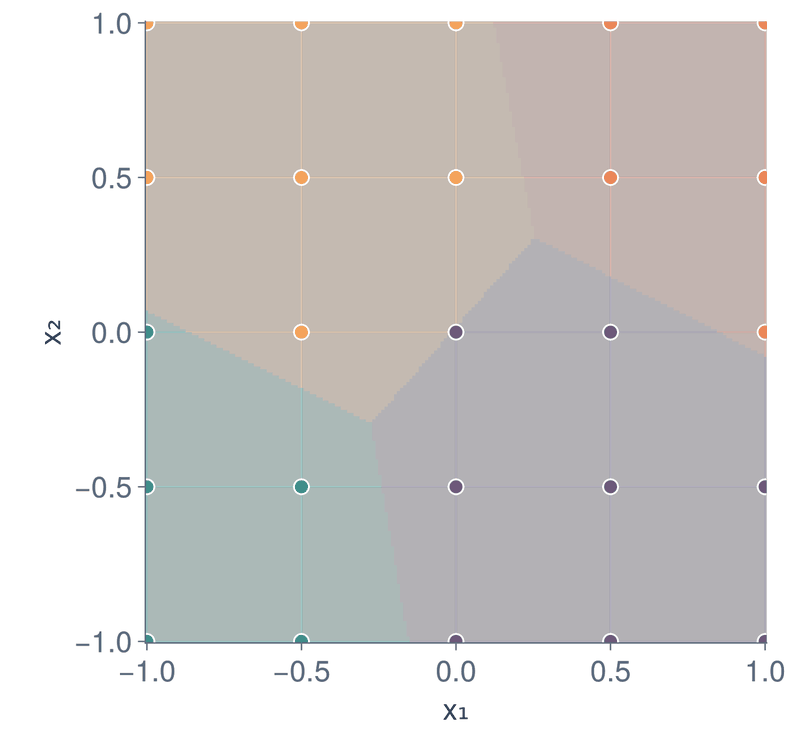 | 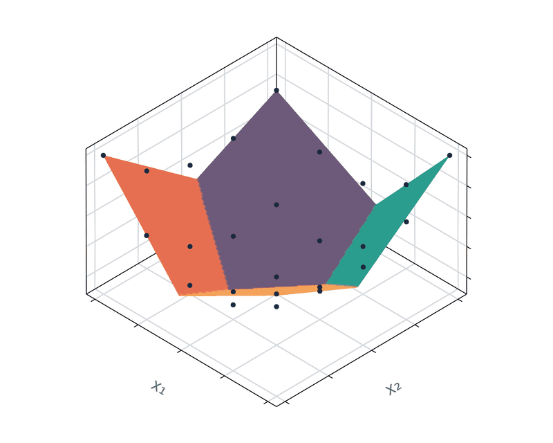 |

## The price of optimality

The model has one binary variable per point and plane, so the solve time grows
quickly with both:

| Points | 3 planes | 5 planes | 7 planes |
|:--|:--|:--|:--|
| 10 | 0.2 s | 0.2 s | 0.8 s |
| 20 | 0.3 s | 0.9 s | 3.9 s |
| 40 | 0.5 s | 2.9 s | 34 s |
| 80 | 1.6 s | 17 s | > 60 s |
| 160 | 8.0 s | > 60 s | > 60 s |

*Time to fit, including the warm start, metric `:l1`, HiGHS on a laptop.
Indicative only.*

The total time is limited by `maxtime` (default 60 s). At the limit, the best
solution found is returned with a warning. The `details` of the
[`FitResult`](@ref) from [`fit`](@ref) report the `status`, `objective`,
`relative_gap`, `big_M_rounds` and `solve_time`; the gap shows how far the
result may be from optimal.

## When to use MILP

**Good for** small data sets of tens of points, few planes where every plane
counts, fits that must stay on one side of the data, and as a reference for
the heuristics.

**Consider instead** [`Interpol`](@ref) for one variable (fast, and exact for
its search space), [`Cluster`](@ref) for many points or variables, and
[`Progressive`](@ref) when you know the accuracy you need.

`Select(MILP(; optimizer, planes = 6); criterion = :tolerance, tolerance = 0.01)`
finds the fewest planes within a tolerance, see
[Choose the number of planes](@ref).
