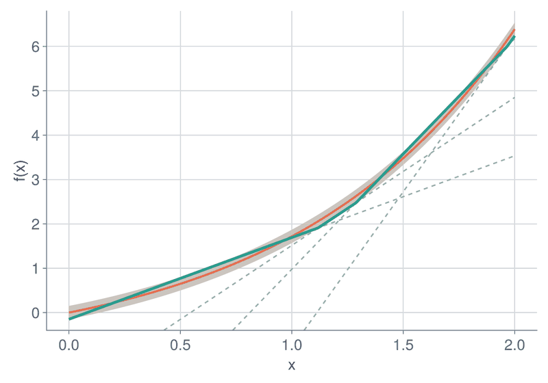

# Progressive and FullOrder

[`Progressive`](@ref) and [`FullOrder`](@ref) are variations of the method of
Kazda & Li (2024), specialized to convex approximations. With
[`Progressive`](@ref) you set the accuracy, and the number of planes follows:
planes are added until the approximation is within `tolerance` of the data.

*``e^x - 1`` approximated within ``±0.15`` (the shaded band).*

## FullOrder: one plane per data point

The full order approximation gives each data point its own plane, which passes
through the point and lies below all other data points. Among such planes, the
one with the smallest deviation from the other points in `metric` is chosen.
The planes are independent of each other, so each is found separately: in
closed form in one variable, and by a small linear program otherwise.

For data that can be interpolated by a convex function, the full order
approximation interpolates it exactly. It is the starting point of
`Progressive`, and is available on its own as [`FullOrder`](@ref).

## Progressive below the data

With the default `strict = :outer`, the planes lie below all data points:

1. Start with one plane, and allocate all points to it.
2. Add the full order plane of the point with the largest gap to the
   approximation.
3. Improve the allocation of the points to planes, refit each plane to its
   points in the metric of the tolerance, and remove planes that are not
   active at any point.
4. Repeat from 2 until the error per point is at most `tolerance`, in the
   `metric`: the mean absolute deviation (`:l1`, the default), the root mean
   square deviation (`:l2`) or the largest deviation (`:max`).

This requires data that can be interpolated by a convex function. Use
[`enforce_curvature`](@ref) first for noisy or non-convex data, which changes
the values as little as possible to make them so.

## Progressive within a band

With `strict = :none`, the approximation lies within `tolerance` of every
data point, above or below, as in the original method of Kazda & Li. With
`strict = :inner`, it lies between the data and `tolerance` above it. A linear
program finds values within the band that are convex, together with planes
below these values, minimizing the total gap between the values and the
planes of their points. When the gap is zero, the maximum of the planes
equals the values at all data points, and so lies within the band. Planes are
added until this is achieved.

The data does not need to be convex, as long as some convex function lies
within the tolerance, so noise up to the tolerance is handled. The `metric` is
not used, since the band is a bound on the largest deviation. In two or more
variables, the convexity constraints and the constraints of the planes are
generated lazily, only when violated.

## When the tolerance is not met

The search can stop before the tolerance is met, e.g. when no convex function
lies within the band. The approximation found is then returned, and `unmet`
decides what else happens: `:warn` (the default), `:error` or `:ignore`. In
all cases `converged` is `false` in the `details` of the
[`FitResult`](@ref) from [`fit`](@ref), and `error` there is the error reached.

## Use with other methods

- For a function rather than data, `everywhere = true` makes `strict = :inner`
  or `:outer` hold over the whole box, see [Control the error](@ref).
- For non-convex data, `DC()` divides the tolerance between the convex and the
  concave part, so that it holds for their sum, see
  [Difference of convex](@ref).
- To meet a tolerance with another algorithm, use [`Select`](@ref) with
  `criterion = :tolerance`.
