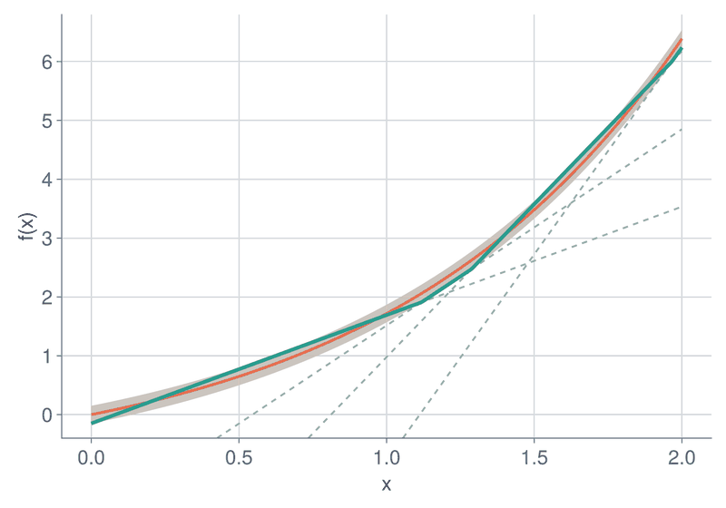

# Choose the number of planes

More planes give a smaller error, but a larger model, and for a
[difference of convex approximation](@ref "Non-convex functions") more binary
variables. There are three ways to settle the number of planes: fix it, let
[`Select`](@ref) choose it by a criterion, or let [`Progressive`](@ref) add
planes until a tolerance is met.

## Fix the number

[`MILP`](@ref), [`Cluster`](@ref) and [`Interpol`](@ref) take the number of
planes as the option `planes` (default 4), and `concave_planes` for the
concave part of a difference of convex approximation (default: the same as
`planes`).

## Let Select choose

[`Select`](@ref) wraps any algorithm with a `planes` option, fits it with `1`
to `planes` planes, and picks the number by `criterion`:

| Criterion | Picks |
|:--|:--|
| `:tolerance` | the fewest planes within `tolerance`, in the metric of the algorithm |
| `:aic`, `:bic` | the best balance of fit and complexity, by the Akaike or Bayesian information criterion |
| `:cv` | the best error on held-out points, by `folds`-fold cross validation with the one standard error rule |

```jldoctest planes
using PiecewiseAffineApprox

x = collect(range(0, 2; length = 100))
data = FunctionEvaluations(x, exp.(x))

r = fit(data, Convex(), Select(Interpol(planes = 10); criterion = :tolerance, tolerance = 0.05))
length(r.func.planes), r.details.planes

# output

(5, 5)
```

The `details` of the [`FitResult`](@ref) also contain the `scores` of each
number of planes, here the mean absolute error of each fit:

```jldoctest planes
round.(r.details.scores[1:6]; digits = 4)

# output

6-element Vector{Float64}:
 0.9899
 0.2397
 0.1058
 0.0593
 0.0379
 0.0263
```

The information criteria and cross validation are for noisy data, where the
error keeps decreasing with more planes and a tolerance is hard to set. They
warn when the largest number of planes is selected, as more planes could then
be better. For [`Interpol`](@ref), the option `selection` is a shorthand:
`Interpol(planes = 10, selection = :tolerance, tolerance = 0.05)`.

## Add planes until a tolerance is met

[`Progressive`](@ref) adds planes until every data point is within
`tolerance`, so you set the accuracy, not the number of planes:



*``e^x - 1`` approximated within ``±0.15`` (the shaded band).*

```jldoctest planes
using HiGHS, JuMP
optimizer = optimizer_with_attributes(HiGHS.Optimizer, MOI.Silent() => true)

[length(approx(data, Convex(), Progressive(; optimizer, tolerance = t, metric = :max, strict = :none)).planes)
 for t ∈ (0.1, 0.01, 0.001)]

# output

3-element Vector{Int64}:
  4
 12
 32
```

See [Progressive and FullOrder](@ref) for how it works.

## Restart randomized algorithms

[`Cluster`](@ref) is a heuristic that starts from a random partition of the
points and finds a local optimum. It runs `trials = 20` times by default and
keeps the best fit. [`Restart`](@ref) does the same for any algorithm with an
`rng` option, and the trials run in parallel when Julia is started with
several threads. Pass a seeded `rng` for reproducible results, independent of
the number of threads.
