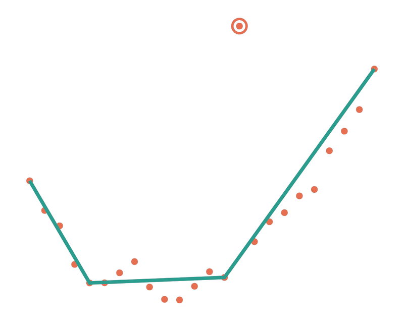
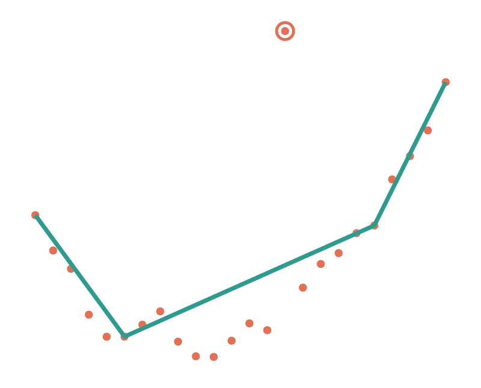
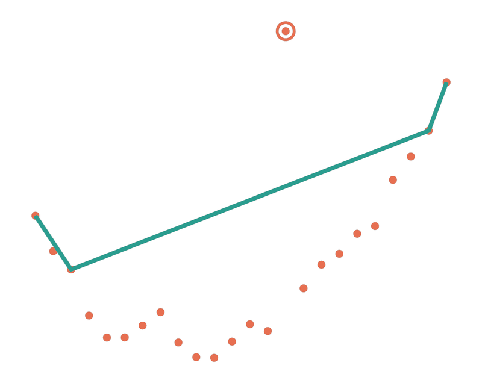
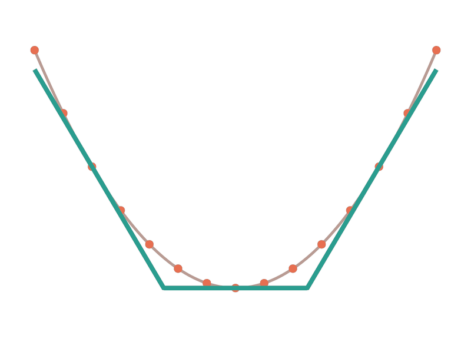
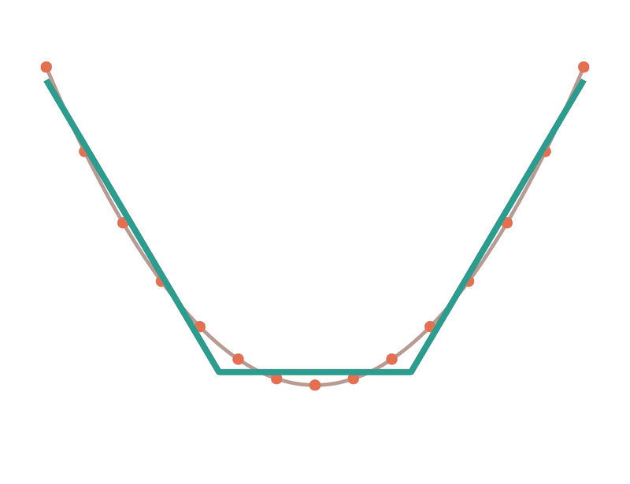
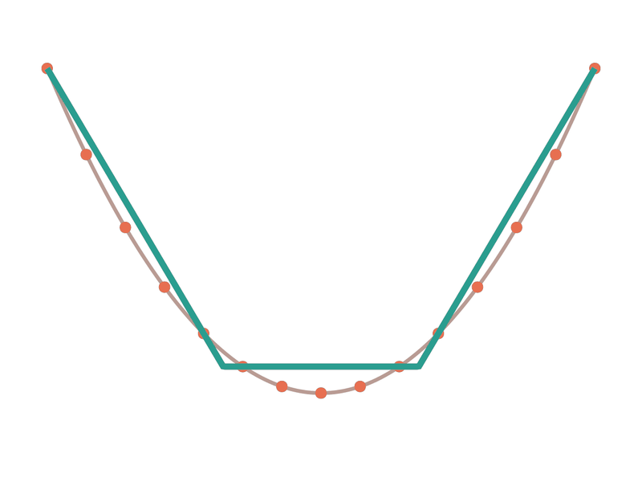
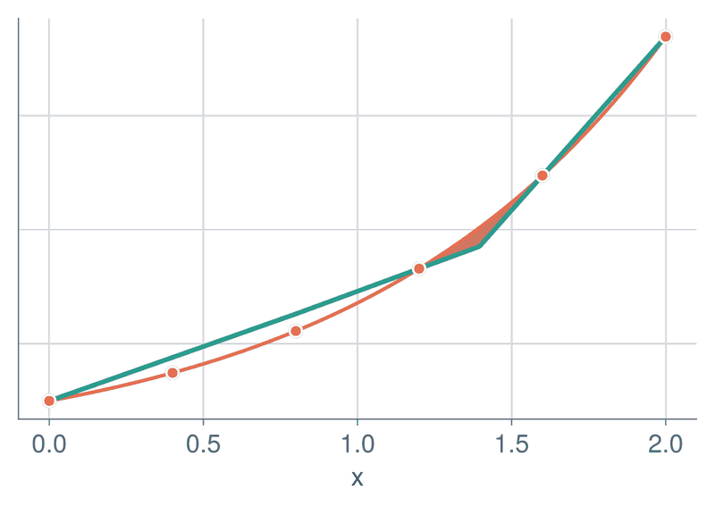
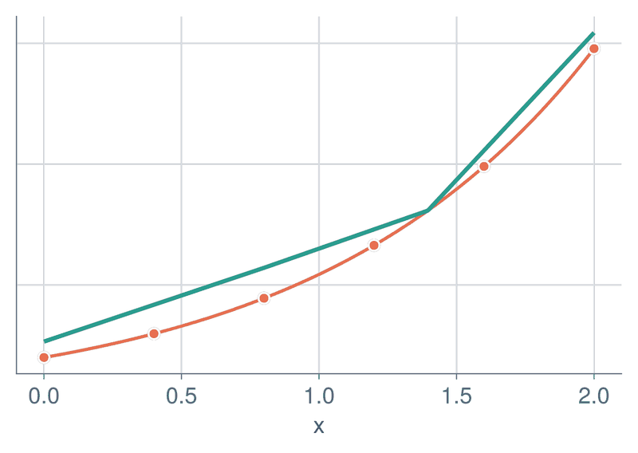

# Control the error

Three choices decide what a good approximation is: how the error is measured
(`metric`), which side of the data the approximation may lie on (`strict`),
and whether that side holds only at the data points or over the whole domain
(`everywhere`). The number of planes, the fourth choice, is described in
[Choose the number of planes](@ref).

## Measure the error

[`approximation_error`](@ref) gives the deviation of an approximation from
data per point, in one of three metrics:

| Metric | Error |
|:--|:--|
| `:l1` | mean absolute deviation |
| `:l2` (or `:rms`) | root mean square deviation |
| `:max` | largest absolute deviation |

[`fit`](@ref) returns a [`FitResult`](@ref) with the error in the metric of
the algorithm, the run time, and `details` from the algorithm, e.g. the
status and gap of a [`MILP`](@ref) solve or the scores of a [`Select`](@ref):

```jldoctest error
using PiecewiseAffineApprox

x = collect(range(0, 2; length = 40))
data = FunctionEvaluations(x, exp.(x))
r = fit(data, Convex(), Interpol(planes = 4))
round(r.error; digits = 4), r.metric, round(approximation_error(r.func, data, :max); digits = 4)

# output

(0.0581, :l1, 0.1271)
```

## The metric of the fit

The algorithms minimize the error in their `metric` option, which is `:l1` by
default, except for [`Cluster`](@ref), where it is `:l2` (solved in closed
form, without a solver). The choice matters most for data with outliers: the
sum of absolute deviations is robust, while the largest deviation lets a single
point decide the fit.

| `metric = :l1` | `metric = :l2` | `metric = :max` |
|:--:|:--:|:--:|
|  |  |  |
| The outlier (circled) barely moves the fit. | The outlier pulls the middle segment up. | The outlier decides the fit. |

[`MILP`](@ref) supports `:l2` only with a solver for mixed-integer quadratic
programs, which HiGHS is not.

## Which side of the data

The `strict` option of [`MILP`](@ref), [`Cluster`](@ref) and
[`Progressive`](@ref) restricts the approximation to one side of the data:

| `strict = :outer` | `strict = :none` | `strict = :inner` |
|:--:|:--:|:--:|
|  |  |  |
| Below the data: an under-estimator, e.g. for relaxations. | The best fit, crossing the data where it pays off. | Above the data: an over-estimator, e.g. for conservative limits. |

For a concave approximation, below and above are interchanged: with `:outer`
it lies above the data, on the side of its planes. For a difference of convex approximation, `strict` refers
to the sum of the parts. The default is `:none`, except for
[`Progressive`](@ref), where it is `:outer`. [`FullOrder`](@ref) always lies
below the data, and [`Interpol`](@ref), whose knots are data points, has no
`strict` option.

```jldoctest error
using HiGHS, JuMP
optimizer = optimizer_with_attributes(HiGHS.Optimizer, MOI.Silent() => true)

below = approx(data, Convex(), MILP(; optimizer, planes = 3, strict = :outer))
all(below(p) ≤ v + 1e-6 for (p, v) ∈ data)

# output

true
```

## Over the whole domain

With `strict`, the approximation is on one side of the data at the data
points, but between them it can cross the function. For a valid relaxation,
bound or conservative constraint, it must stay on its side over the whole box.
When approximating a function, `everywhere = true` shifts the planes by the
largest amount the approximation is on the wrong side:

| `strict = :inner` | `strict = :inner, everywhere = true` |
|:--:|:--:|
|  |  |
| Above the samples, but below the function in between (red). | Shifted to stay above the function on the whole box. |

```jldoctest error
algorithm = Progressive(; optimizer, tolerance = 0.05, metric = :max, strict = :inner)
r = fit(x -> x[1]^2, [(-1, 1)], Convex(), algorithm; everywhere = true)
b = r.details.bounds
b.below ≤ 0, round(b.above; digits = 3)

# output

(true, 0.054)
```

The approximation is above ``x^2`` everywhere, by at most 0.054: the
tolerance at the samples plus the shift. The function must be convex or
concave on the box as stated, which is used to find where the approximation is
furthest on the wrong side. With `refinements = n`, the approximation is first
refitted up to `n` times with the points on the wrong side added to the data,
which can give a smaller shift. `everywhere` is not available for `DC()`.

[`error_bounds`](@ref) gives the largest deviations above and below the
function over the box for any convex or concave approximation:

```jldoctest error
pwa = approx(x -> x[1]^2, [(-1, 1)], Convex(), Interpol(planes = 4))
b = error_bounds(pwa, x -> x[1]^2)
round(b.below; digits = 4), round(b.above; digits = 4)

# output

(0.0, 0.0744)
```
