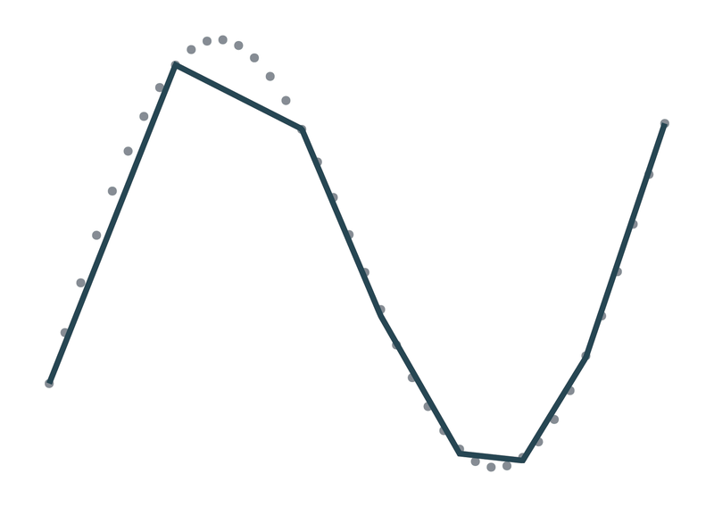

# Non-convex functions

A function that is neither convex nor concave is approximated with
[`DC`](@ref) as the sum of a convex and a concave piecewise affine function, a
[`DCFunc`](@ref). Any continuous piecewise affine function can be written this
way, and any of the algorithms fits the two parts.



The payoff is in the model: a convex part is cheap to minimize and a concave
part cheap to maximize, so binary variables are only needed for the part that
works against the objective. See [Difference of convex](@ref) for how the parts
are found.

## A recipe

```jldoctest dc; output = false
using JuMP, PiecewiseAffineApprox, HiGHS
optimizer = optimizer_with_attributes(HiGHS.Optimizer, MOI.Silent() => true)

# Fit: few planes in the concave part, which needs binaries when minimizing
dc = approx(sin, [(0, 2π)], DC(), Interpol(planes = 5, concave_planes = 2))

# Model: z is only minimized, so only the concave part needs binaries
m = Model(optimizer)
@variable(m, 0 ≤ x ≤ 2π)
z = dc(x; direction = PiecewiseAffineApprox.Epigraph())
@constraint(m, x ≥ 4)
@objective(m, Min, z)
optimize!(m)
round(value(x); digits = 2), round(value(z); digits = 2)

# output

(4.49, -0.98)
```

1. **Keep the concave part small.** Set `concave_planes` lower than `planes`:
   when the output is minimized, each concave plane costs a binary variable.
2. **Tell the model the direction.** Pass `direction = Epigraph()` when the
   output is only minimized, and `Hypograph()` when it is only maximized. The
   direction types are not exported. The default, `Graph()`, makes the output
   equal to the approximation, with binaries for both parts.
3. **Bound the inputs.** The formulations need a box for the inputs. The
   domain recorded by `approx` is the default, or give `bounds`.
4. **One variable is easiest.** The Δ-formulation, the default in one variable
   when bounds are available, needs no big-M values and puts binaries only at
   the kinks against the direction, see [Formulations](@ref).

## Fit the parts with different algorithms

[`Alternating`](@ref) fits the convex part with one algorithm and the concave
part with another, e.g. an exact [`MILP`](@ref) for a small concave part and
[`Cluster`](@ref) for the convex part:

```jldoctest dc
using StableRNGs

f(x, y) = sin(2x) + y^2
a = Alternating(
    convex = Cluster(planes = 6, rng = StableRNG(1)),
    concave = MILP(; optimizer, planes = 2),
)
dc2 = approx(f, [(-1, 1), (-1, 1)], DC(), a; nsamples = 8)
length(dc2.convex.planes), length(dc2.concave.planes)

# output

(6, 2)
```

## Tolerance and side refer to the sum

A `tolerance`, as in [`Progressive`](@ref) or [`Select`](@ref) with
`criterion = :tolerance`, applies to the approximation as a whole: it is
divided between the two parts so that their sum is within the tolerance of the
data. In the same way, `strict = :outer` puts the sum below the data and
`:inner` above it.

```jldoctest dc
x = collect(range(0, 2π; length = 60))
data = FunctionEvaluations(x, sin.(x))
r = fit(data, DC(), Progressive(; optimizer, tolerance = 0.05, metric = :max, strict = :none))
r.details.converged, approximation_error(r.func, data, :max) ≤ 0.05

# output

(true, true)
```

## Plot

With Makie loaded, `plot(x, y, dc)` shows the convex and concave parts in
separate axes together with their planes, see [Plot approximations](@ref).
