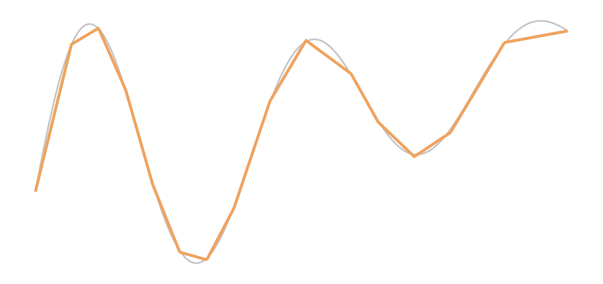
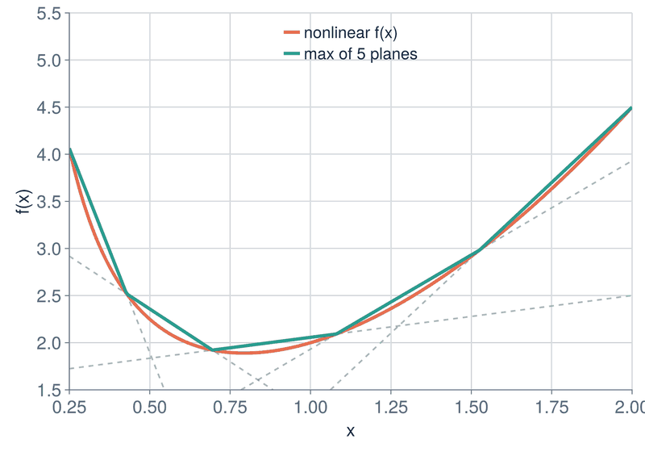
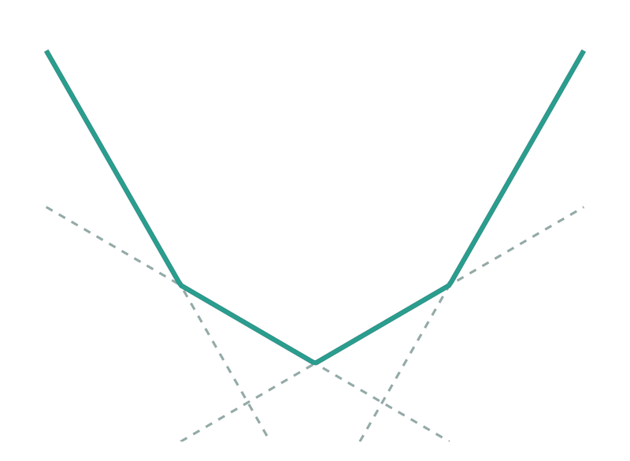
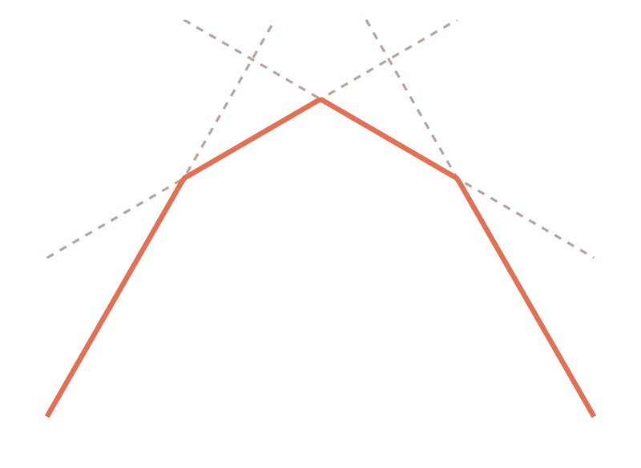
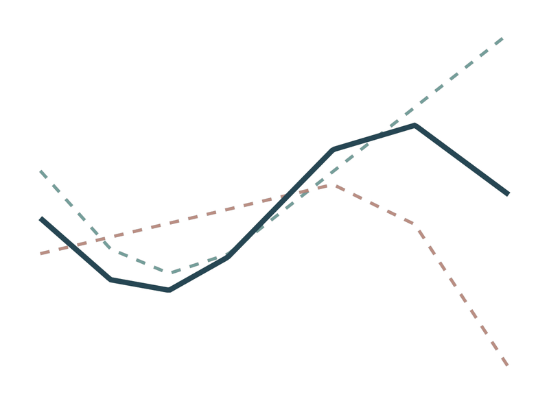

# PiecewiseAffineApprox.jl

*Piecewise affine approximations of functions and data, ready to use in
[JuMP](https://jump.dev/) optimization models.*



PiecewiseAffineApprox fits piecewise affine functions to a function or to
measured data, and adds them to JuMP models as linear or mixed-integer
constraints. Convex and concave functions become pure linear programs, and any
other function is approximated as the sum of a convex and a concave part, with
binary variables only where the curvature works against the objective.

## Why piecewise affine approximations?

| | |
|:--|:--|
| **Nonlinear relations are everywhere** | Costs, efficiencies, losses and physical laws appear in planning and operations models. |
| **Linear solvers are fast and global** | LP and MILP solvers are robust, scale to large models and prove optimality. |
| **Planes bridge the gap** | A convex function is approximated by the maximum of a few planes, so minimizing it stays a linear program. |



*``f(x) = x^2 + 1/x`` approximated by the maximum of five planes (dashed).*

## From function or data to optimization model

1. **Input:** a function and a box to sample it in, or measured points.
2. **Shape:** [`Convex`](@ref), [`Concave`](@ref), or [`DC`](@ref) (a
   difference of convex functions) for anything else.
3. **Algorithm:** five fitting algorithms, all behind one interface.
4. **Model:** call the result on JuMP variables to add it to a model.

```jldoctest; output = false
using JuMP, PiecewiseAffineApprox, HiGHS

# 1–3: a convex approximation of x² + 1/x on [0.2, 2] with five planes
cost = approx(x -> x[1]^2 + 1 / x[1], [(0.2, 2)], Convex(), Interpol(planes = 5))

# 4: use it like a function of JuMP variables
m = Model(HiGHS.Optimizer)
set_silent(m)
@variable(m, 0.2 ≤ x[1:3] ≤ 2)
@constraint(m, sum(x) ≥ 3)
@objective(m, Min, sum(cost(x[i]) for i ∈ 1:3))
optimize!(m)
round(objective_value(m); digits = 1), round(cost(1.0); digits = 1)

# output

(6.1, 2.0)
```

Called with numbers, `cost` evaluates the approximation; called with JuMP
variables, it adds the approximation to their model and returns the output.
[`fit`](@ref) does the same as [`approx`](@ref), and also reports the error,
the run time and diagnostics of the algorithm.

## Three shapes of approximation

| `Convex()` | `Concave()` | `DC()` |
|:--:|:--:|:--:|
|  |  |  |
| The maximum of its planes. Minimizing it needs no binary variables. | The minimum of its planes. Maximizing it needs no binary variables. | Convex plus concave: any continuous piecewise affine function. Binaries only where the curvature works against the objective. |

## Five fitting algorithms, one interface

| Algorithm | Idea | Based on | Variables | Solver | You choose |
|:--|:--|:--|:--|:--|:--|
| [`MILP`](@ref) | Optimal assignment of points to planes | Toriello & Vielma (2012) | Any | MILP solver | Planes |
| [`Cluster`](@ref) | Partition the points and refit, from random starts | Magnani & Boyd (2009) | Any | None for least squares | Planes |
| [`Interpol`](@ref) | Best knots among the data points: a shortest path with at most ``K`` arcs | Dahl & Realfsen (2000) | One | Optional | Planes |
| [`Progressive`](@ref) | Add planes until a tolerance is met | Kazda & Li (2024) | Any | LP solver | Tolerance |
| [`FullOrder`](@ref) | One plane per data point | Kazda & Li (2024) | Any | LP solver | — |

Swap the algorithm and keep the rest. Every algorithm fits convex data, and
the package handles concave and non-convex data, sampling of functions and
validation of the input for all of them. See the [Overview](@ref) of the
methods for how they work.

## Which method when?

| Situation | Use |
|:--|:--|
| One variable, quick and good | [`Interpol`](@ref) |
| Few planes, the best possible fit | [`MILP`](@ref) |
| Many points or several variables | [`Cluster`](@ref) |
| A known accuracy requirement | [`Progressive`](@ref), or [`Select`](@ref) with `criterion = :tolerance` |
| A valid bound or relaxation | `strict = :outer` or `:inner`, with `everywhere = true`, see [Control the error](@ref) |
| Neither convex nor concave | `DC()` with few concave planes, see [Non-convex functions](@ref) |

## Installation

```julia
using Pkg
Pkg.add("PiecewiseAffineApprox")
```

The fitting algorithms that solve optimization problems need a solver, e.g.
[HiGHS](https://github.com/jump-dev/HiGHS.jl). Plotting is available when
[Makie](https://docs.makie.org/stable/) or
[Plots](https://docs.juliaplots.org/stable/) is loaded, and saving and loading
when [JSON](https://github.com/JuliaIO/JSON.jl) is loaded.

## References

- Coffrin, C., Knueven, B., Holzer, J., & Vuffray, M. (2021). The impacts of
  convex piecewise linear cost formulations on AC optimal power flow.
  *Electric Power Systems Research*, 199, 107191.
  [doi:10.1016/j.epsr.2021.107191](https://doi.org/10.1016/j.epsr.2021.107191)
- Dahl, G., & Realfsen, B. (2000). The cardinality-constrained shortest path
  problem in 2-graphs. *Networks*, 36(1), 1–8.
  [doi:10.1002/1097-0037(200008)36:1<1::AID-NET1>3.0.CO;2-B](https://doi.org/10.1002/1097-0037(200008)36:1%3C1::AID-NET1%3E3.0.CO;2-B)
- Kazda, K., & Li, X. (2024). A linear programming approach to difference-of-convex
  piecewise linear approximation. *European Journal of Operational Research*,
  312(2), 493–511.
  [doi:10.1016/j.ejor.2023.07.026](https://doi.org/10.1016/j.ejor.2023.07.026)
- Magnani, A., & Boyd, S. P. (2009). Convex piecewise-linear fitting.
  *Optimization and Engineering*, 10(1), 1–17.
  [doi:10.1007/s11081-008-9045-3](https://doi.org/10.1007/s11081-008-9045-3)
- Toriello, A., & Vielma, J. P. (2012). Fitting piecewise linear continuous
  functions. *European Journal of Operational Research*, 219(1), 86–95.
  [doi:10.1016/j.ejor.2011.12.030](https://doi.org/10.1016/j.ejor.2011.12.030)
